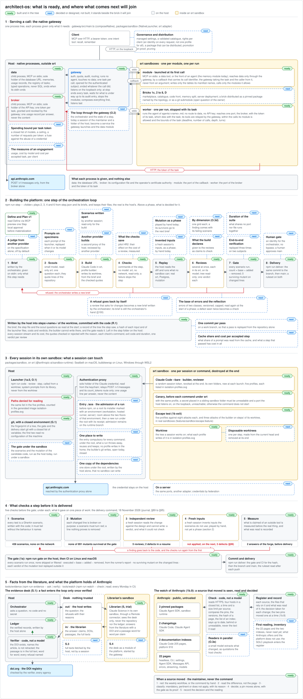

# architect-os

An MCP platform for agent work, built in public, and the method used to build it. Every Claude Code session the Step loop launches runs in its own sandbox, the gate checks scenario identities, mutation results for changed production lines and independent replay, and a desk, tried outside production, verifies the facts taken from the published literature.

**Status.** [Define v1](docs/define.md) and [Plan v1](docs/plan.md) are available on `main`. The Builder works in its own worktree with read-only Git metadata. The `./aos` entry admits repository commands under a marked runtime root, and the Linux gate runs scenarios, mutation tests and independent replay across multiple runners. The design is [`docs/design/platform-v3-srt.md`](docs/design/platform-v3-srt.md). The experiment log, failures included, is [`docs/design/journal.md`](docs/design/journal.md); the section numbers below (§) point into it.

## What the system brings

| What                                            | Measured                                                                                                                                                                                                                                                                                                                                                                                                                                                                                                                                                                                                                                                                                                                                                                                                                                           | Where                                                                                             |
| ----------------------------------------------- | -------------------------------------------------------------------------------------------------------------------------------------------------------------------------------------------------------------------------------------------------------------------------------------------------------------------------------------------------------------------------------------------------------------------------------------------------------------------------------------------------------------------------------------------------------------------------------------------------------------------------------------------------------------------------------------------------------------------------------------------------------------------------------------------------------------------------------------------------- | ------------------------------------------------------------------------------------------------- |
| Isolation, at a known price                     | In real sandboxes, no profile reads a secret planted in the home folder or in another sandbox's folder (`features/sandbox/escape.feature`). What each of the five profiles may write, and which hosts it may reach, is a list taken from its file, in the image of the profiles, `docs/diagrams/isolation-profiles.svg`. It costs about 11 % more than the same session without a sandbox, on short tasks. A sandbox starts cold in 0.2 to 0.7 s (median) on the three hosts measured.                                                                                                                                                                                                                                                                                                                                                             | [Cost baseline](#cost-baseline-the-fixed-cost-of-a-sessions-context-on-short-fix-tasks), §30, §38 |
| A context sized to the task                     | A session started with explicit inputs only costs 0.166 of the owner's everyday configuration on short fix tasks (95 % interval 0.131 to 0.212), with every task solved in both.                                                                                                                                                                                                                                                                                                                                                                                                                                                                                                                                                                                                                                                                   | Cost baseline                                                                                     |
| A gate that cannot be talked into green         | The executed scenarios must be exactly the expected ones, base + added − removed, each step passed; on Linux, each reported mutant on a changed production line must be detected unless the debt register of older code names it or it is marked equivalent with its reason, and the gate replays the mutation tool's verdicts instead of trusting them. On the evidence desk it found 10 survivors that three model reviews had missed.                                                                                                                                                                                                                                                                                                                                                                                                           | §20, §37                                                                                          |
| Reviews that cannot write the worktree          | The reviewer session cannot write the worktree, and its verdict is checked against a contract. On the evidence desk it found a link that made the host read outside the exchange folder, a named pipe that hung the verifier, and an unbounded read.                                                                                                                                                                                                                                                                                                                                                                                                                                                                                                                                                                                               | §33, §37                                                                                          |
| Least privilege per process                     | In the native gateway, `data` alone holds the database URL and the broker alone holds the API key; a worker reaches one port, the broker, with a token that dies with its task; a module reaches data only through the gateway. A call opens a task in the name of the client the gateway authenticated, and a stop ends every task and waits for what is under way, up to its audit entry.                                                                                                                                                                                                                                                                                                                                                                                                                                                        | [The native gateway](#the-native-gateway), §41, §42                                               |
| Defects stopped before a push, at a known price | Wiring the native gateway took four steps and an end-to-end proof. Before anything was pushed, the reviews, the mutation run and the replay on the host found: a task left open for ever when its token could not be granted; a stop that returned while a module was still starting or a data operation still running; a message to a child already closed that would have brought the process down; client tokens as `openssl rand -base64 32` writes them refused without a word; and three pieces of code that no scenario could tell from their absence, which were removed. The build sessions cost $2.52 and the review sessions $9.57 (the orchestrator's own session is not counted). That ratio is a starting point, not a property of the architecture: see [The cost of review](#the-cost-of-review-and-what-is-expected-to-lower-it). | §40 to §45                                                                                        |
| Facts taken from publications, verified         | A question is answered from the literature and accepted only if each DOI exists, names the cited article, is not retracted, and the quoted passage is found word for word in the full text the librarian supplied. Three real questions: 61 passages, 21 articles.                                                                                                                                                                                                                                                                                                                                                                                                                                                                                                                                                                                 | §37, §39                                                                                          |

## How it works



Run repository commands through `./aos -- PROGRAM [ARG ...]`. Admission checks the marked runtime root and available space before starting the program. See the [quick start](#quick-start).

The architecture diagram marks implemented components as `ready` and planned work as `next`.

### One sandbox per session

Each session, and each command the loop runs for a step, is one `srt` process ([`@anthropic-ai/sandbox-runtime`](https://github.com/anthropics/sandbox-runtime)) started from a profile and destroyed at the end. The credential never enters it: what a profile holds is a token, named by the variable that carries it in the token list of its row (a session token that only the host's proxy accepts for the builder and the reviewer, a task token that the broker accepts for a worker, none for a checker or a module). What a profile reaches is its network list: the builder the authentication proxy and the package registry, the reviewer the authentication proxy, a module the callback of the gateway, a worker the broker, a check nothing. What it writes is in the [generated sandbox profile diagram](docs/diagrams/isolation-profiles.svg): for each profile, the paths it opens for writing and those it closes for writing, its network list and its token variables, then the count of the paths denied for reading. One function produces that file whole from the five profile files, `./aos -- npm run diagram:isolation` writes it after a build, and the gate requires the file to equal what the function produces (`features/arch/isolation-diagram.feature`). The architecture diagram is drawn by hand: it shows who starts what and what holds the credential, and the reviewer of each change reads it. The builder can write its worktree and home cache. Its profile denies writes to the repository’s `.git` directory and the worktree’s `.git` pointer. The host commits the changes after review. Moving the cache under the admitted runtime root remains planned. Before each command it starts under srt, the adapter runs a canary under the same profile: it must fail to read a secret planted in a sibling sandbox folder and to connect to a port the host listens on, on the loopback; any other verdict refuses the start (`features/sandbox/canary.feature`). Details: [`packages/sandbox/README.md`](packages/sandbox/README.md).

### The native gateway

The platform is one process tree. The gateway authenticates, counts, audits and routes; it runs no agent and touches no data. It starts two children outside srt, on a closed list of commands and variables with nothing inherited from the host: `data`, and the broker, the only process that holds the API key. Everything else runs in a sandbox: a module is started at its first call, a worker once per run and stopped with its task. The gateway composes all of it before it listens on anything, so a start that fails leaves nothing behind; its stop ends every task and returns only when nothing is under way. Each of these is a scenario, not a sentence: see [What is proven](#what-is-proven-and-how-to-replay-it). It is proven end to end: the process started by its entry file with nothing but its configuration, its two real children, real sandboxes, and a scripted model reached over HTTPS.

### One step of the orchestration loop

An orchestrator delegates each step to a fresh session that receives only the brief of that step. Nothing a session reports is taken on trust: the host reads the diff and runs what the sandbox cannot, other sessions review without being able to write the worktree, and the gate decides. After a refusal, the orchestrator writes a new brief that names the findings. A step is routed by the host, never by a session (a session started as the loop starts it has no tool to delegate, measured): each phase goes to the least costly model able to do it (§13 of the design). Three pieces of that routing are built. Before the build, scouts on a small model, read-only, each answer one question by quoting lines of the repository; the host reads each file and keeps only the quotations it finds on those lines, so a small model can be wrong but cannot pass an error off as a fact, and the build session receives them as data. On their first real run three scouts returned 104 quotations in under 30 seconds each, for 1.6 cents in all, every one of them correct; and the build that received them cost and re-read as much as the same build without them, within the noise of two identical builds (§79). They are kept for the work that is made of quotations, the reading of the watch, not as a default before a build. After the build, the step plays the checks it names (types, format, scenarios): commands without a model, one after the other, each in a sandbox that reaches nothing and cannot write the worktree. A check that fails stops the step before any review is paid, and the reviews receive the results as data. A green check is an indication and not a proof, since the build wrote the worktree: the replay on the host and the gate stay the judges. Then the step can have several reviews, played at the same time up to the bound its step file sets (two by default), each on its own model; and every session says what it cost by model. At its end, whether the step passed or was refused (a failure of the tool, such as a session that fails, publishes nothing), the host writes into `steps/<name>/` of the worktree what the step saw: the brief, the step file and the scout questions as it read them at the start, and a record made of the tree the step started from (its commit, the git tree of the whole working directory, clean or not), a hash of each input and of each launcher file it relied on, then numbers and values of closed lists (durations, costs by model, the outcome of each check, the verdict of each review). No text of a session enters it. The folder is committed with the code, the builder profile cannot write there, a name is used once, and the gate reads every folder: a brief edited after its run turns the gate red. A step is launched from the root of its worktree or refused. One that started from a clean tree can be played again from the repository alone; the record is not signed, and is worth what the commit that carries it is worth (§99). The first folders show what a record says: the first pass of a correction, stopped by a check before any review, is there as refused, with its brief (§100). A second pilot tried a review made of one reading, without a tool, of the brief and the diff: on one change that carried two known security defects, the large model named both for 0.56 dollar in 99 seconds where the review that explores took 0.86 dollar and 194 seconds, and the middle model missed one; but only the review that explores saw what the change had left untouched, a diagram and this README (§81). The reading is a part of a review, not a replacement. The same commit is then delivered to `feat/gate-1a` and to `main`; a ruleset on both refuses a deletion, a rewrite, and a commit on which the two jobs of the gate are not green, to an account without the right to bypass it; the delivery command needs no bypass, and stops before `main` on any evaluation of the ruleset other than `pass`. Design: [`docs/design/orchestration-fable-5-2.md`](docs/design/orchestration-fable-5-2.md).

### How a step is tested and verified

No check is trusted alone. Scenarios say what the code must do. Mutation asks whether a scenario would notice each changed line breaking. A session that did not write the code reviews it against the design. Another fresh session invents inputs nobody used, with the expected result taken from the contract and not from the code: this fourth check is played by hand, and is owed to the loop as a phase ([What comes next](#what-comes-next)). It was not applied between its first three steps and the delivery command, which was built without it; on the step that followed, 103 invented inputs found three defects that the review, the checks and two mutation runs had not seen, one of them in the fingerprint of the tree itself (§99). And a review is never done by the author: a change the orchestrator had written by hand was given to a review session, which found three defects in it; their correction went back to a build session by a brief, in three passes (§100). And what is claimed of an outside tool is measured before the real thing. Each check that ran found what the others had not: on the delivery command, the reviews found two defects in the resume of an interrupted delivery, the mutation run found survivors the reviews had passed, on three full runs, and the check of the tree after the gate found a file the gate itself had left there. The gate then decides on counts read from the runner's own report, on the host and in CI. A commit then reaches the branches by one command, `./aos -- npm run deliver -- <name>`: six phases bound to the full hash of the commit, read once: preconditions, a trial branch, the gate on the host, the two jobs of CI for that hash, the publication to both branches with the evaluation of the ruleset read after each push, and tidying. It pushes only when both required checks are green for the hash, never forces, and a run started again allows nothing a first run would not (§89 to §95). Design: [`docs/design/platform-v3-srt.md`](docs/design/platform-v3-srt.md), §7, and [`docs/design/orchestration-fable-5-2.md`](docs/design/orchestration-fable-5-2.md), §4.

### Gate coverage and limits

The [Linux workflow](.github/workflows/gate.yml) splits the functional Cucumber suite across two runners and the mutation inventory across sixteen lanes. Each chain uses a distinct runner for Stryker and another for independent replay. The Linux check requires the complete union of the planned mutants and replay receipts. The separate `gate-macos` job runs the sandbox scenarios. The mutation inventory covers changed lines and retains the full scope required to prove debt retirement. The hosted runner tries scenarios from the touched components first. The Stryker dry run and static mutants without an early failing witness still use the complete mutation catalogue.

The native inventory starts from changed production lines and includes native mutant spans that intersect them. The canary and files required to verify retirement of mutation debt have explicit whole-file scopes. A distribution of exact spans keeps nested groups apart on each runner. The verifier recalculates the inventory, checks the producer and receipt against the checkout and effective attempt, and ties the final replay record to the combined report by SHA-256. A static or hybrid mutant can still require the full mutation profile.

### The evidence desk

The loop does not take facts from the open web. It asks a question; a librarian answers from the published literature; a verifier on the host, plain code and not a model, accepts the answer or sends it back with named reasons. The contract does not say who the librarian is. Today it is Claude Science, in a session the owner starts once, which takes the questions as they arrive through a custom Remote connector. Design and threat model: [`docs/design/evidence-desk.md`](docs/design/evidence-desk.md).

### The watch of Anthropic

The platform holds things of Anthropic: two pinned packages, and the behaviours its mechanisms rely on, which the documentation describes: the options the worker gives the Agent SDK, the flags and variables of the sessions of the loop, the format of an agent and of a skill, the fields of a request the auth proxy lets through, the models the topology names. A committed register names each of these 28 sources, the files that rely on it, and what was read of it. A command compares it with what is published, in five seconds and without a model, and a workflow runs it every Monday, beside a second job that asks for the advisories published on the locked dependencies.

The command says that a source moved and which files to read again. It never says what to do about it: the maintainer reads the difference, classifies each change (mandatory, such as a deprecation, a change of default, a removal or a security fix; pertinent; or not applicable, with its reason), decides, and records the reading. A change is kept because it is pertinent, whether or not it brings security or lowers a cost, and no source leaves the register. What the command reads is not trusted: it goes to a closed list of four hosts and prints identifiers, versions, addresses and counts, never the text. On its first run against the real sources it was red, rightly: the Agent SDK had been published one version ahead of its pin the day before, and no page had been read yet. Design and threat model: [`docs/design/anthropic-watch.md`](docs/design/anthropic-watch.md); what was read and decided: [`docs/claude-code-watch.md`](docs/claude-code-watch.md).

### The cost of review, and what is expected to lower it

On the native gateway, review cost almost four times the build ($9.57 against $2.52), and no review was enough alone: each one found defects in the corrections that followed the one before. The owner's reading is that this is the price of iterative work done without comparison and without a history of similar work, and that it should fall once the orchestration loop feeds back on itself: a reflection at the end of a step, which records the decision taken and what the step produced, for the sessions that come after. Most agent harnesses and orchestration loops end with such a phase.

This is a hypothesis, stated before it is measured. Today the loop stops at the commit; the lessons of a step reach the next one only through the brief the orchestrator writes by hand, and the experiment log is a record of work and proofs written for a person, not an input of the sessions. The methodology of that feedback is still to be defined, so that it gets an architecture as fitted and as organised as the ones of the orchestration loop and of the isolation: where the record lives, who reflects, how a session is given what concerns it without loading everything, and how the effect is measured. It will start from the published state of the art, taken through the evidence desk, and its measure will be registered before it runs: review rounds and cost per step, against the four steps of the native gateway (§40 to §45). Design: [`docs/design/orchestration-fable-5-2.md`](docs/design/orchestration-fable-5-2.md), §4.

A first measure outside review came from inputs invented by a fresh session, a mechanism taken from Anthropic's `code-modernization` plugin at the owner's request. It was played on three steps whose code has since been removed with Docker (§51 to §53): on the first, 57 inputs for $1.64 found three defects that neither two reviews nor the mutation run had seen; on the second, 71 inputs for $1.51 found one more. On that result the owner validated the principle. It is written in the design and not built into the loop's tool. It was then left unapplied until the step that put the briefs of a step in the repository (§99): 103 inputs for $2.92, four of them failing on the host, three defects found, where the build and its review had cost $4.05.

## Where it stands

Every brick that is built carries the mark `ready` in the image of the architecture above; every point decided and not built carries `next`, beside the brick it will join. What each brick is, its limits and the journal sections of its work are in [`docs/bricks.md`](docs/bricks.md).

The host reads a pending Define v1 handoff from a trusted local prd-gen plugin with `./aos -- npm run --silent define -- <run_id> <prd-gen-plugin-root>`. It validates the run ID, unique requirement and criterion IDs, and acceptance coverage. A passed gate yields one JSON line. A refused handoff leaves stdout empty. The pilot read a passing and a refused checkpoint over stdio and verified both checkpoints remained byte-for-byte unchanged. Define leaves its producer decision and checkpoint intact. See the [Define reader and recorded pilot](docs/define.md).

Use `./aos -- npm run --silent plan:proposal` to read the producer’s verified proposal for the accepted Define checkpoint. Alternatively, `plan draft` sends the accepted handoff and Step name to one signed-in CLI: Claude Code, Codex or Antigravity. Choose a provider, model and timeout. The receipt records the outcome, elapsed time and available usage. An operator can also import a completed Antigravity exchange offline. Both paths feed the same preview and approval. See [native CLI setup and draft receipts](docs/plan-models.md).

Plan prepares a preview for one Step from an accepted Define handoff, a proposal and an operator-selected policy. Its manifest fingerprints the three inputs and every proposed output. The [planning baseline](docs/plan.md#measure-the-checkpoint-to-plan-path) records stage timings and outcomes. Materialization requires a separate local approval bearing the reviewed manifest fingerprint and a new destination outside Git checkouts. The approval carries no identity attestation. A stale or refused decision leaves the destination untouched. Step execution is a separate command. The integration scenario checks the archive against the approved bundle with controlled sessions. Automated exploration and a measured replay through Deliver remain pending. See [Plan preparation and operator approval](docs/plan.md).

## What comes next

`next` marks a point of the architecture that is decided or designed and not built. This section is the roadmap: it is kept so that nothing decided is lost between two sessions of work. A point that is not started is here only, and not in the table above; it leaves this section in the commit that builds it and enters that table with its journal section. A decision that is not built enters this section in the commit that records it. The architecture diagram shows planned work with a dashed border. The order is the order of work, and since 18 November 2026 each point is weighed by what it takes out of the orchestrator's hands: the target is a team of two product engineers and several agents, and what separates the loop from it is what the orchestrator still does itself, outside every port. "Loop design" is [`docs/design/orchestration-fable-5-2.md`](docs/design/orchestration-fable-5-2.md), whose §14 gives this order and its reasons; "platform design" is [`docs/design/platform-v3-srt.md`](docs/design/platform-v3-srt.md).

| Point                                                     | What is missing                                                                                                                                                                                                                                                                                                                                                                                                                                                                                                                                                                                                                                                                                                                                                                                                                                                                                                                                                                                                                                                                                                                                                                                                                                                                                                                                                                                                                                                                                                                                                                                                                                                                                                                                                                                                                                                                                                                                                                                                                                                                                | Written in                                                                           |
| --------------------------------------------------------- | ---------------------------------------------------------------------------------------------------------------------------------------------------------------------------------------------------------------------------------------------------------------------------------------------------------------------------------------------------------------------------------------------------------------------------------------------------------------------------------------------------------------------------------------------------------------------------------------------------------------------------------------------------------------------------------------------------------------------------------------------------------------------------------------------------------------------------------------------------------------------------------------------------------------------------------------------------------------------------------------------------------------------------------------------------------------------------------------------------------------------------------------------------------------------------------------------------------------------------------------------------------------------------------------------------------------------------------------------------------------------------------------------------------------------------------------------------------------------------------------------------------------------------------------------------------------------------------------------------------------------------------------------------------------------------------------------------------------------------------------------------------------------------------------------------------------------------------------------------------------------------------------------------------------------------------------------------------------------------------------------------------------------------------------------------------------------------------------------- | ------------------------------------------------------------------------------------ |
| **1. What is copied, what is written, and what drifts**   |                                                                                                                                                                                                                                                                                                                                                                                                                                                                                                                                                                                                                                                                                                                                                                                                                                                                                                                                                                                                                                                                                                                                                                                                                                                                                                                                                                                                                                                                                                                                                                                                                                                                                                                                                                                                                                                                                                                                                                                                                                                                                                |                                                                                      |
| `next` One place to write                                 | The [runtime entry](docs/bricks.md) requires a marked root for repository commands. The Builder still has access to `${home}/.cache`, logs and Step folders still need bounds, and two Gates in one checkout share `reports/`. The remaining work begins with the profiles, which still need to move the session npm cache under the root and close writes to the home folder, with write and neighbour-read tests on the real engine (the Builder already denies writes to Git metadata), the temporary folder of the run given to the engine's host and to the child, and the logs and step folders under `state`; the gate, with a lock per tree (a lock whose owner died restores the mutated file first), its outputs under `run`, a receipt bound to the commit that the delivery reads, a closed environment for the gate the delivery starts, and scenarios without a hard-coded `/tmp` or a sweep by name; the end of a run, with its processes stopped, the removal of what the host created and of the runs whose owner is dead, one adapter for all streams that applies the ceiling and replaces the token by a mark before a byte of it is stored, on both channels and across chunks, the publication of `steps/<name>` by one rename, and the time `state` and `cache` are kept; the measure of the peaks, which replaces the provisional floors, then a hard capacity per run. The credential of the owner and the key of the broker are never under the root, and a scenario refuses a profile or a launcher that puts one there. The guarantee covers the writes of the host and of the sessions; the candidate code the gate runs as the host is the next point. The container benchmark is already removed.                                                                                                                                                                                                                                                                                                                                                               | Loop design, §14 (one place to write)                                                |
| `next` The gate under the sandbox                         | The gate runs the scenarios and the mutation of the candidate code as the host, the one way left for code nobody has read to write where it wants; the guarantee of the point above is not whole before this one. They are to run under a sandbox, the host keeping the plan, the verdict and the publication. A design step of its own, since the sandbox scenarios start the engine themselves                                                                                                                                                                                                                                                                                                                                                                                                                                                                                                                                                                                                                                                                                                                                                                                                                                                                                                                                                                                                                                                                                                                                                                                                                                                                                                                                                                                                                                                                                                                                                                                                                                                                                               | Loop design, §14 (one place to write)                                                |
| `next` One copy of the dependencies                       | Each worktree holds its own copy of the dependencies (542 MB measured, 337 MB of them one native binary); a build session can write them, and the host then runs them. A package manager with one store (the owner's direction), under `<root>/cache/` and written by the host alone, with an installer that does not come from the candidate tree, its version pinned with its fingerprint, what it installed and from which lock file recorded, no install script and no list of exceptions, and a refusal when the store and the tree are not on one device. The builder loses the registry the day the host alone installs, and cannot write the dependency folder of the root nor of any internal package; a new dependency becomes a request to the host. The lock file with two documents is read whole by the watch of advisories and by the inventory, which becomes a command (a scenario with a known dependency in the second document); the five workflows that install, and the scenario on install scripts, follow the installer; the two lock files of the repository (root and `bench`) are converted. No migration before these are proven: the conversion of both lock files judged on the graph; a witness package that shows no install script runs; the identity of files and the real space of a second tree; the whole chain, with a mutation that is not empty, on both systems; and a seventh measure, in two real sandboxes, for each system and each mode of import, with a replaced folder, an absent store, a damaged store and an install interrupted before its publication. None is proven today. It follows the place to write, not the gate under the sandbox: the store lives under the runtime root, and its form is chosen with the hard capacity, since a space mounted for each run opposes hard links to a common store                                                                                                                                                                                                                               | Loop design, §14 (one copy, second contestation)                                     |
| `next` Disposable worktrees                               | Three worktrees are kept in step with the current head by hand after each delivery. One worktree per step, made from the current head and removed at its end; the launcher is the main checkout; the delivery tree is made by the delivery command; the reports of the gate are pruned                                                                                                                                                                                                                                                                                                                                                                                                                                                                                                                                                                                                                                                                                                                                                                                                                                                                                                                                                                                                                                                                                                                                                                                                                                                                                                                                                                                                                                                                                                                                                                                                                                                                                                                                                                                                         | Loop design, §14                                                                     |
| **2. A loop that corrects itself**                        |                                                                                                                                                                                                                                                                                                                                                                                                                                                                                                                                                                                                                                                                                                                                                                                                                                                                                                                                                                                                                                                                                                                                                                                                                                                                                                                                                                                                                                                                                                                                                                                                                                                                                                                                                                                                                                                                                                                                                                                                                                                                                                |                                                                                      |
| `next` The base of errors and the reflection step         | Errors of two classes (understanding, technique), versioned, capped, read again at the start of a phase; a defect seen twice becomes a check. Checks owed: a change of code that leaves its diagram as it was; a count or a state this README gives that the tree no longer gives                                                                                                                                                                                                                                                                                                                                                                                                                                                                                                                                                                                                                                                                                                                                                                                                                                                                                                                                                                                                                                                                                                                                                                                                                                                                                                                                                                                                                                                                                                                                                                                                                                                                                                                                                                                                              | Loop design, §4                                                                      |
| `next` Invented inputs at verification                    | A fresh session invents inputs the build did not use. Played by hand (§51 to §53, then §99, where it found three defects): it is not a phase of the step, and only the maintainer's hand applies it                                                                                                                                                                                                                                                                                                                                                                                                                                                                                                                                                                                                                                                                                                                                                                                                                                                                                                                                                                                                                                                                                                                                                                                                                                                                                                                                                                                                                                                                                                                                                                                                                                                                                                                                                                                                                                                                                            | Loop design, §4                                                                      |
| `next` Mutation as a phase of the step                    | The host plays the mutation by hand between two passes, on the lines a pass changed. The step plays it, and gives the survivors to the next brief                                                                                                                                                                                                                                                                                                                                                                                                                                                                                                                                                                                                                                                                                                                                                                                                                                                                                                                                                                                                                                                                                                                                                                                                                                                                                                                                                                                                                                                                                                                                                                                                                                                                                                                                                                                                                                                                                                                                              | Loop design, §4 and §14                                                              |
| `next` A refusal goes back by itself                      | A review that asks for changes becomes a new brief written by the orchestrator. Since 18 November 2026 the orchestrator no longer writes the correction itself (§100); the brief of the next pass is still its hand                                                                                                                                                                                                                                                                                                                                                                                                                                                                                                                                                                                                                                                                                                                                                                                                                                                                                                                                                                                                                                                                                                                                                                                                                                                                                                                                                                                                                                                                                                                                                                                                                                                                                                                                                                                                                                                                            | Loop design, §14                                                                     |
| `next` What the build declares, given to the reviews      | A review does not see the report of the build session, so that nothing a session says is taken on trust. It then reports as a defect a departure from the brief that the report justified with a proof (§102). The departures a build declares are given to the reviews as claims to check, not to believe                                                                                                                                                                                                                                                                                                                                                                                                                                                                                                                                                                                                                                                                                                                                                                                                                                                                                                                                                                                                                                                                                                                                                                                                                                                                                                                                                                                                                                                                                                                                                                                                                                                                                                                                                                                     | Loop design, §14                                                                     |
| `next` Scenarios written apart, then frozen               | The build session writes the code and its own scenarios. Another session writes them from the brief, and the sandbox profile of the build makes them read-only                                                                                                                                                                                                                                                                                                                                                                                                                                                                                                                                                                                                                                                                                                                                                                                                                                                                                                                                                                                                                                                                                                                                                                                                                                                                                                                                                                                                                                                                                                                                                                                                                                                                                                                                                                                                                                                                                                                                 | Loop design, §14                                                                     |
| **3. Replayable work**                                    |                                                                                                                                                                                                                                                                                                                                                                                                                                                                                                                                                                                                                                                                                                                                                                                                                                                                                                                                                                                                                                                                                                                                                                                                                                                                                                                                                                                                                                                                                                                                                                                                                                                                                                                                                                                                                                                                                                                                                                                                                                                                                                |                                                                                      |
| `next` One commit per pass                                | A pass that starts from the uncommitted work of the pass before has an exact fingerprint and cannot be replayed from the repository alone. One commit per pass on a work branch, delivered as one                                                                                                                                                                                                                                                                                                                                                                                                                                                                                                                                                                                                                                                                                                                                                                                                                                                                                                                                                                                                                                                                                                                                                                                                                                                                                                                                                                                                                                                                                                                                                                                                                                                                                                                                                                                                                                                                                              | Loop design, §14                                                                     |
| `next` Cache share and cost per accepted step             | A session says its cost by model. It does not say what share of its prompt was read from the cache, nor what a step that passed has cost in all                                                                                                                                                                                                                                                                                                                                                                                                                                                                                                                                                                                                                                                                                                                                                                                                                                                                                                                                                                                                                                                                                                                                                                                                                                                                                                                                                                                                                                                                                                                                                                                                                                                                                                                                                                                                                                                                                                                                                | Loop design, §14                                                                     |
| `next` The duration of the suite                          | The hosted functional suite now runs in two shards. The unsharded run took 5 minutes 35 seconds for 2,897 scenarios on 18 November 2026, and the mutation tool plays them once more, but for `features/repository` and `features/arch`, before any mutant. On 18 November 2026 that first run reached a default bound nobody had set, and the gate turned red on a green commit (§101). The bound is now explicit; what is owed is to measure where the time goes and to run at the same time what shares neither a port nor a file                                                                                                                                                                                                                                                                                                                                                                                                                                                                                                                                                                                                                                                                                                                                                                                                                                                                                                                                                                                                                                                                                                                                                                                                                                                                                                                                                                                                                                                                                                                                                            | Platform design, §7                                                                  |
| **4. Limits on what is paid by use**                      |                                                                                                                                                                                                                                                                                                                                                                                                                                                                                                                                                                                                                                                                                                                                                                                                                                                                                                                                                                                                                                                                                                                                                                                                                                                                                                                                                                                                                                                                                                                                                                                                                                                                                                                                                                                                                                                                                                                                                                                                                                                                                                |                                                                                      |
| `next` The broker bounds what a task token can spend      | Its policy admits any model and any `max_tokens`: a closed list of models, a ceiling, a number of requests per token. A fuse against the abuse of a credential                                                                                                                                                                                                                                                                                                                                                                                                                                                                                                                                                                                                                                                                                                                                                                                                                                                                                                                                                                                                                                                                                                                                                                                                                                                                                                                                                                                                                                                                                                                                                                                                                                                                                                                                                                                                                                                                                                                                 | Loop design, §14                                                                     |
| `next` The delivery gate                                  | The orchestrator pushes to `main` itself, with the owner's bypass of the ruleset. Closing it takes an identity of its own for the orchestrator, without bypass, and a human approval before `main`. The choice of the gate is the owner's                                                                                                                                                                                                                                                                                                                                                                                                                                                                                                                                                                                                                                                                                                                                                                                                                                                                                                                                                                                                                                                                                                                                                                                                                                                                                                                                                                                                                                                                                                                                                                                                                                                                                                                                                                                                                                                      | Loop design, §14                                                                     |
| **5. Evals of prompts**                                   |                                                                                                                                                                                                                                                                                                                                                                                                                                                                                                                                                                                                                                                                                                                                                                                                                                                                                                                                                                                                                                                                                                                                                                                                                                                                                                                                                                                                                                                                                                                                                                                                                                                                                                                                                                                                                                                                                                                                                                                                                                                                                                |                                                                                      |
| `next` Prompts replayed on specimens                      | The prompts of the launcher are tested on their form only. Each gets a specimen and an expected result, replayed when the prompt or the model changes, on the host                                                                                                                                                                                                                                                                                                                                                                                                                                                                                                                                                                                                                                                                                                                                                                                                                                                                                                                                                                                                                                                                                                                                                                                                                                                                                                                                                                                                                                                                                                                                                                                                                                                                                                                                                                                                                                                                                                                             | Loop design, §4 and §14                                                              |
| **6. The routing on four models**                         |                                                                                                                                                                                                                                                                                                                                                                                                                                                                                                                                                                                                                                                                                                                                                                                                                                                                                                                                                                                                                                                                                                                                                                                                                                                                                                                                                                                                                                                                                                                                                                                                                                                                                                                                                                                                                                                                                                                                                                                                                                                                                                |                                                                                      |
| `next` What the checks take off a review (pilot HR2)      | The checks without a model are built; what they remove from the cost of a review is not measured                                                                                                                                                                                                                                                                                                                                                                                                                                                                                                                                                                                                                                                                                                                                                                                                                                                                                                                                                                                                                                                                                                                                                                                                                                                                                                                                                                                                                                                                                                                                                                                                                                                                                                                                                                                                                                                                                                                                                                                               | Loop design, §13                                                                     |
| `next` Review by dimension (O.3d)                         | One grid per dimension (defects, security, conformity to the brief), a finding of correctness given with the scenario that fails, and the review in one reading measured on a second specimen                                                                                                                                                                                                                                                                                                                                                                                                                                                                                                                                                                                                                                                                                                                                                                                                                                                                                                                                                                                                                                                                                                                                                                                                                                                                                                                                                                                                                                                                                                                                                                                                                                                                                                                                                                                                                                                                                                  | Loop design, §13 and §14                                                             |
| `next` The reading of the watch, and the inventory (O.3e) | Readers in parallel, the first reading of the 22 pages and of the two indexes, then the inventory of what Anthropic offers and the platform does not use. Anthropic's SDLC playbook enters the watch                                                                                                                                                                                                                                                                                                                                                                                                                                                                                                                                                                                                                                                                                                                                                                                                                                                                                                                                                                                                                                                                                                                                                                                                                                                                                                                                                                                                                                                                                                                                                                                                                                                                                                                                                                                                                                                                                           | Loop design, §13; [`docs/design/anthropic-watch.md`](docs/design/anthropic-watch.md) |
| **7. The full cycle**                                     |                                                                                                                                                                                                                                                                                                                                                                                                                                                                                                                                                                                                                                                                                                                                                                                                                                                                                                                                                                                                                                                                                                                                                                                                                                                                                                                                                                                                                                                                                                                                                                                                                                                                                                                                                                                                                                                                                                                                                                                                                                                                                                |                                                                                      |
| `next` Explorations and remaining human gates             | The host reads a validated Define v1 checkpoint and records approval before materializing a Step bundle. Driving the Define questions, three explorations before Plan, and the remaining gates still need integration                                                                                                                                                                                                                                                                                                                                                                                                                                                                                                                                                                                                                                                                                                                                                                                                                                                                                                                                                                                                                                                                                                                                                                                                                                                                                                                                                                                                                                                                                                                                                                                                                                                                                                                                                                                                                                                                          | Loop design, §14                                                                     |
| `next` The verification from end to end                   | An intention, a specification, the code, the gate, replayed three times on two subjects: the scenarios written from one replay must pass on the code built from another                                                                                                                                                                                                                                                                                                                                                                                                                                                                                                                                                                                                                                                                                                                                                                                                                                                                                                                                                                                                                                                                                                                                                                                                                                                                                                                                                                                                                                                                                                                                                                                                                                                                                                                                                                                                                                                                                                                        | Loop design, §14                                                                     |
| `next` A judge from another provider                      | One request without a tool, on the specification alone; off by default, since the specification leaves for a second provider                                                                                                                                                                                                                                                                                                                                                                                                                                                                                                                                                                                                                                                                                                                                                                                                                                                                                                                                                                                                                                                                                                                                                                                                                                                                                                                                                                                                                                                                                                                                                                                                                                                                                                                                                                                                                                                                                                                                                                   | Loop design, §14                                                                     |
| `next` A builder from another provider                    | The loop knows one builder, a Claude session wired in `step-tool.ts`. A port for the build phase and a second proxy of the host, with its own token per run and a fixed destination; the session under srt never holds the owner's credential. The rule: `step.json` names the builder, and a step whose review of correctness is of the builder's provider is refused. Before any production code, two trials played by a bench outside production: the first, with a fake local upstream, has the pinned client write a file in a disposable tree under srt; the second is one real request, which needs the owner's consent; if it fails for a reason of rights or eligibility, the build stops and no key paid by use is substituted without the owner. The session runs under srt with its home, configuration, logs, caches and temporary folder in the run folder, its telemetry, automatic update, web search and history off, and only the port of the proxy open; the client's own sandbox is not removed by default, the first measure says whether the two overlap; the proxy forwards one route to a fixed destination with a closed list of headers and refuses a model other than the step's; the owner's consent is held by the host alone, outside the root, renewed by it under a lock, and revoking a run and withdrawing the consent are two separate acts; the client is pinned with its fingerprint, checked before each launch, and its source enters the register of the watch; a number of requests and a ceiling of tokens per run come from the builder's descriptive file; `record.json` records provider, model, effort, fingerprint and version of the client, and the usage, in tokens and not in dollars, must agree with the proxy's log. Then, after the write place: the port and the Claude adapter (B.1), the second proxy on a fake upstream (B.2), the adapter of the other provider under srt (B.3), the consent held by the host and the rule of the reviewer (B.4). The judge above is another point: one request without a tool, which never builds | Loop design, §14 (a builder from another provider)                                   |
| **8. From a laptop to a server**                          |                                                                                                                                                                                                                                                                                                                                                                                                                                                                                                                                                                                                                                                                                                                                                                                                                                                                                                                                                                                                                                                                                                                                                                                                                                                                                                                                                                                                                                                                                                                                                                                                                                                                                                                                                                                                                                                                                                                                                                                                                                                                                                |                                                                                      |
| `next` The loop through the gateway (O.2)                 | The orchestrator is a session of the maintainer, and the state of a step is a local folder of the host: both are outside every port. They become a service the gateway launches and the data module                                                                                                                                                                                                                                                                                                                                                                                                                                                                                                                                                                                                                                                                                                                                                                                                                                                                                                                                                                                                                                                                                                                                                                                                                                                                                                                                                                                                                                                                                                                                                                                                                                                                                                                                                                                                                                                                                            | Loop design, §14; platform design, §8                                                |
| `next` Governance and distribution                        | Managed settings, a validated catalogue, rights per client, a package that can be distributed, promotion on proof, pruning                                                                                                                                                                                                                                                                                                                                                                                                                                                                                                                                                                                                                                                                                                                                                                                                                                                                                                                                                                                                                                                                                                                                                                                                                                                                                                                                                                                                                                                                                                                                                                                                                                                                                                                                                                                                                                                                                                                                                                     | Loop design, §14                                                                     |
| `next` The measures of an engagement                      | Usage, cost by model and cost per accepted task, per client                                                                                                                                                                                                                                                                                                                                                                                                                                                                                                                                                                                                                                                                                                                                                                                                                                                                                                                                                                                                                                                                                                                                                                                                                                                                                                                                                                                                                                                                                                                                                                                                                                                                                                                                                                                                                                                                                                                                                                                                                                    | Loop design, §14                                                                     |
| **9. The platform**                                       |                                                                                                                                                                                                                                                                                                                                                                                                                                                                                                                                                                                                                                                                                                                                                                                                                                                                                                                                                                                                                                                                                                                                                                                                                                                                                                                                                                                                                                                                                                                                                                                                                                                                                                                                                                                                                                                                                                                                                                                                                                                                                                |                                                                                      |
| `next` Bricks 1c, 2 to 8, D                               | Marketplace, catalogue, code front, memory split, server deployment. Open for the marketplace: a brick distributed on its own as a pinned package named by the topology, or as a git submodule (the owner's question of 18 November 2026; a package keeps the proof tied to one version)                                                                                                                                                                                                                                                                                                                                                                                                                                                                                                                                                                                                                                                                                                                                                                                                                                                                                                                                                                                                                                                                                                                                                                                                                                                                                                                                                                                                                                                                                                                                                                                                                                                                                                                                                                                                       | Platform design, §8                                                                  |
| `next` The evidence desk, S.3 and S.4                     | Full texts fetched by the host; the desk as a platform module                                                                                                                                                                                                                                                                                                                                                                                                                                                                                                                                                                                                                                                                                                                                                                                                                                                                                                                                                                                                                                                                                                                                                                                                                                                                                                                                                                                                                                                                                                                                                                                                                                                                                                                                                                                                                                                                                                                                                                                                                                  | [`docs/design/evidence-desk.md`](docs/design/evidence-desk.md)                       |

Two pieces follow no external cycle and are kept: the mutation of the changed lines, with the replay of its verdicts, which the Linux job of the gate applies to every commit; and the invented inputs at verification, which the maintainer plays by hand and which the loop owes as a phase (point 2 above).

## What is proven, and how to replay it

| Claim                                                                                                                                                                                                                                                                                                                                                                                                                                                                                           | Proof                                                                                                                                                                                                                                                                                                                                                                                                                                                                                                                                                                                                                                                             | Command                                                                                                                                                                                                            |
| ----------------------------------------------------------------------------------------------------------------------------------------------------------------------------------------------------------------------------------------------------------------------------------------------------------------------------------------------------------------------------------------------------------------------------------------------------------------------------------------------- | ----------------------------------------------------------------------------------------------------------------------------------------------------------------------------------------------------------------------------------------------------------------------------------------------------------------------------------------------------------------------------------------------------------------------------------------------------------------------------------------------------------------------------------------------------------------------------------------------------------------------------------------------------------------- | ------------------------------------------------------------------------------------------------------------------------------------------------------------------------------------------------------------------ |
| In real sandboxes, each of the five profiles fails eight attacks: it reads no secret planted in the home folder nor in another sandbox's folder, writes neither directly under the home folder nor the pre-commit hook, reaches neither example.com (through the proxy of its environment and directly) nor 169.254.169.254 nor the Postgres socket, and makes no nested user namespace; the builder can neither rewrite nor forge a step folder under `steps/`, nor replace `steps/` by a link | `features/sandbox/escape.feature`: 43 attacks in real sandboxes, 8 witnesses without a sandbox where the same attacks succeed, 11 positive controls; Linux and macOS in CI                                                                                                                                                                                                                                                                                                                                                                                                                                                                                        | `./aos -- npm run gate -- --job macos`                                                                                                                                                                             |
| The platform runs on Windows through WSL2                                                                                                                                                                                                                                                                                                                                                                                                                                                       | The suite as it was on the day of the measure (§38): 1,196 scenarios green out of 1,196, twice; the srt bench gives the same result as Linux CI, test by test: 92 pass, 5 fail, 3 residual, 6 findings                                                                                                                                                                                                                                                                                                                                                                                                                                                            | `npm test`, then `cd bench && npm run bench:sandbox`                                                                                                                                                               |
| The credential stays on the host                                                                                                                                                                                                                                                                                                                                                                                                                                                                | `packages/sandbox/features/auth-proxy.feature`, `credential.feature`                                                                                                                                                                                                                                                                                                                                                                                                                                                                                                                                                                                              | `npm test`                                                                                                                                                                                                         |
| A tool call crosses the platform through real sandboxes                                                                                                                                                                                                                                                                                                                                                                                                                                         | `features/sandbox/recall.feature`, `remember.feature`: gateway, module, worker and data, with a scripted model                                                                                                                                                                                                                                                                                                                                                                                                                                                                                                                                                    | `npm test`                                                                                                                                                                                                         |
| The gateway runs as one process, by its entry file                                                                                                                                                                                                                                                                                                                                                                                                                                              | `features/sandbox/gateway-entry.feature`: `node gateway/dist/src/serve.js` given only its configuration; `data` and the broker as its real children, module and worker under real srt, a scripted model over HTTPS; a client remembers, then recalls what it remembered; SIGTERM ends it with code 0 and nothing left listening or running                                                                                                                                                                                                                                                                                                                        | `npm test`                                                                                                                                                                                                         |
| A client's call crosses the production composition with its identity                                                                                                                                                                                                                                                                                                                                                                                                                            | `features/sandbox/gateway-native.feature`: a real MCP client over HTTP with a bearer token, module and worker under real srt, a scripted model; the registry holds one task in the client's name, ended `completed`, and its usage; without a token, `UNAUTHORIZED` and no task opened                                                                                                                                                                                                                                                                                                                                                                            | `npm test`                                                                                                                                                                                                         |
| A stop leaves nothing under way, and a start that fails leaves nothing behind                                                                                                                                                                                                                                                                                                                                                                                                                   | `gateway/features/gateway.feature`, `native-composition.feature`, `adapters.feature`: an opening, an end, a data operation or a module launch in flight is waited for; a step of the stop that fails does not prevent the next; a refused topology or a taken port is refused before anything listens                                                                                                                                                                                                                                                                                                                                                             | `npm test`                                                                                                                                                                                                         |
| The configuration has no default and its refusals leak nothing                                                                                                                                                                                                                                                                                                                                                                                                                                  | `gateway/features/native-config.feature` (79 scenarios): every variable named in its refusal, never its value; the store that keeps nothing is chosen by name                                                                                                                                                                                                                                                                                                                                                                                                                                                                                                     | `npm test`                                                                                                                                                                                                         |
| The gate refuses a filtered run, a skipped step, a surviving mutant that the debt register does not name, and a wrong verdict of the mutation tool                                                                                                                                                                                                                                                                                                                                              | `tools/test-gate/features/`, run against fixture reports                                                                                                                                                                                                                                                                                                                                                                                                                                                                                                                                                                                                          | `./aos -- npm run gate`                                                                                                                                                                                            |
| The cost figures above                                                                                                                                                                                                                                                                                                                                                                                                                                                                          | `baseline/`: tasks, harness, raw data, analysis                                                                                                                                                                                                                                                                                                                                                                                                                                                                                                                                                                                                                   | `./aos -- npm run baseline:campaign`                                                                                                                                                                               |
| The overhead figures above                                                                                                                                                                                                                                                                                                                                                                                                                                                                      | `baseline/results/overhead-*.jsonl`                                                                                                                                                                                                                                                                                                                                                                                                                                                                                                                                                                                                                               | `./aos -- npm run baseline:overhead-analyze -- baseline/results/overhead-<date>.jsonl` analyses the kept results; the program that produced them is in the history, at `be831caa7fbe`, last commit that changes it |
| The verifier refuses an unknown DOI, another article's DOI, a retracted article and an invented passage                                                                                                                                                                                                                                                                                                                                                                                         | `tools/evidence/features/` (280 scenarios), and one real run against `doi.org`: one sound answer verified, four false ones refused                                                                                                                                                                                                                                                                                                                                                                                                                                                                                                                                | `npm test`, then `./aos -- npm run evidence -- verify <ledger> <desk>`                                                                                                                                             |
| Claude Science answers the desk's questions without a gesture per question, once its session is started                                                                                                                                                                                                                                                                                                                                                                                         | Three questions, each verified at the first submission, in 7 to 19 minutes                                                                                                                                                                                                                                                                                                                                                                                                                                                                                                                                                                                        | [`bench/evidence-remote`](bench/evidence-remote/README.md), with the app                                                                                                                                           |
| A commit reaches both branches by one command, and a run started again does not replay a gate whose green verdict already names the commit                                                                                                                                                                                                                                                                                                                                                      | `tools/deliver/features/` (539 scenarios, none on the network), and two real deliveries: one stopped before publication then resumed, one in a single run; each checked again outside the command (§95)                                                                                                                                                                                                                                                                                                                                                                                                                                                           | `./aos -- npm run deliver -- <name>`                                                                                                                                                                               |
| The git the host starts receives only a closed list of the host's variables, taken by name                                                                                                                                                                                                                                                                                                                                                                                                      | `packages/sandbox/features/tree-fingerprint.feature`, `tools/test-gate/features/closed-environment.feature`, `tools/deliver/features/command.feature`: with real git and two real repositories, a `GIT_DIR`, an injected configuration or a program named by a variable changes nothing; a fake git records the names it receives, exactly those of the list; 73 attacks invented by a fresh session, three of which failed when they were written (§102); the same scenarios green with forty variables of a CI runner, another language and time zone, and a home whose git configuration converts line endings, excludes files and sets hooks that fail (§103) | `npm test`                                                                                                                                                                                                         |

On the four steps of the native gateway, none of the 404 mutants of the changed lines survived at the gate (44, 44, 206, 110); on the evidence desk, none of 645; on the worker's failure message, none of 42.

## What is not proven

- **Windows beyond the suite.** Windows is supported through WSL2; native Windows is not planned for now (srt's own support for it is alpha and was not tried). Under WSL2 the suite passed and the srt bench gave the result of Linux CI, test by test (the overhead measures were also taken there), but the gate with its mutation and real sessions were not run there (§38, §39).
- **The native gateway against Postgres and the real API.** Its end-to-end proof runs on the store that keeps nothing and before a scripted model. The same path against Postgres and against the real API has not been played through the entry file.
- **Rights per client.** One client profile exists (`owner`): every authenticated client has the owner's rights until a second profile and its resolution per client arrive (brick 2). It is written in the design, §8.
- **Savings on real work.** The baseline measures short fix tasks whose tests are named. Its own limits are stated below.
- **The context targets of the design** (tokens per task, per layer): they belong to bricks 2 and 3.
- **The orchestration loop against other ways of working.** One pilot, one session per cell: no statistical conclusion (§32).
- **That the cost of review falls.** It is expected to, once the loop feeds back on itself; nothing of that is built or measured yet, and its methodology is not defined ([The cost of review](#the-cost-of-review-and-what-is-expected-to-lower-it)).
- **That a quoted text is the article.** The verifier finds the passage in the text the librarian saved, and ties that text to the DOI by its title. Each record says so (`quote_in_supplied_text`); the host fetching the text itself is step S.3.
- **That a claim follows from its passage.** The verifier checks that the DOI exists, names the article and is not retracted, and that the passage is in the text supplied for it. The reasoning stays with review.
- **Claude Science without a person.** A session is started by hand; the app has no programmatic entry, and Anthropic's Consumer Terms forbid automating it. The question has been put to Anthropic (§37, §39).
- **That the register of the watch names everything.** The command proves that no named source moved since it was read. A page a mechanism relies on and that the register forgot is seen by nobody; the two documentation indexes bound that risk, since every new page is reported, without closing it. The first reading of the 22 pages, and the inventory of what Anthropic offers and the platform does not use, are not done.
- **That a recorded step was played.** The record of `steps/<name>/` is not signed: the gate proves that the brief is the one the record hashed, not that a session ran. It is worth what its commit is worth: the gate, the review and the ruleset. And no step has been played again from its folder yet.
- **The stops of the delivery command against the real forge.** A red CI, a job left without a runner and its rerun, an evaluation of the ruleset other than `pass`, a branch that moved: scenarios play them against a scripted client; no real delivery has met one yet (§95). One stop has been met for real: a red gate, on 18 November 2026; the command stopped before any push and published nothing (§101).
- **The mutation debt register.** It names each known survivor by line and column, so an insertion above an entry used to strand it without anything saying so: 114 of its 295 entries no longer pointed at the code they named (§35, §60). The gate now refuses an entry that does not hold its text, on every run and whatever the run mutated, and `test-gate debt realign` puts back the entries whose code only moved, never by guessing: 112 were moved, 2 whose code is gone were removed, and the 293 that remain all point at their code (§66). Every survivor of a full mutation of the three files concerned has its entry. What is not proven is the register against the full run on Linux, which only runs from the default branch.

## Cost baseline: the fixed cost of a session's context, on short fix tasks

**What this measures, and what it does not.** It measures the cost a launch configuration adds to every session, on short tasks: one-line defects whose failing tests are named in the prompt, solved in a median of 4 to 8 turns depending on the configuration (29 at most) and about 25 seconds (13 to 46 seconds for 80 % of them). On sessions that short, the context loaded at start dominates the bill. It does **not** measure the cost of a real working session: on a long session of many turns, that fixed part is diluted and the gap between configurations is expected to shrink, by an amount not measured here. Every task was solved in every configuration (180 / 180), so these tasks cannot tell whether a configuration solves harder work less well. And srt is an isolation layer, not a saving: what it adds is the protection of the host, at a measured price.

Three configurations, with the same model (`claude-sonnet-5-5`), Claude Code version (2.1.318), prompt, permission mode and single allowed command:

- **host**: Claude Code as the owner uses it every day, with plugins, MCP servers, hooks and memory;
- **host-bare**: the same Claude Code with `--bare`, every input explicit, no sandbox;
- **srt**: the code tool of this repository (`packages/sandbox`): `--bare` inside the srt sandbox, the model reached through a local proxy that alone holds the credential. The session runs under the builder profile, whose lists are in the [generated sandbox profile diagram](docs/diagrams/isolation-profiles.svg).

Twenty tasks on six public repositories of the owner (Python and TypeScript). Each injects a one-line defect into a disposable copy of a pinned commit and asks to make the named tests pass again without touching them; the check is verified to pass at the commit and fail with the defect before every session, and runs again on the host after it. Three repetitions per task and configuration. Cost is `total_cost_usd` of `claude -p --output-format json`, at public prices. The target repositories are never pushed; their branches and tags are compared before and after.

| Configuration | Solved  | Mean cost per session | Mean input tokens | Cache written per session | Mean turns |
| ------------- | ------- | --------------------- | ----------------- | ------------------------- | ---------- |
| host          | 60 / 60 | $0.192                | 169,300           | 42,100                    | 4.5        |
| host-bare     | 60 / 60 | $0.028                | 31,900            | 5,600                     | 7.8        |
| srt           | 60 / 60 | $0.032                | 41,600            | 6,100                     | 8.4        |

Cost ratios paired by task, mean and 95 % interval (bootstrap over the 20 tasks), **for these short sessions**: host-bare / host **0.146** (0.123 to 0.173); srt / host **0.166** (0.131 to 0.212); srt / host-bare **1.108** (1.021 to 1.213).

**Reading.** The gap between host and the two others comes from the context the usual configuration loads at every session: about 42,000 tokens written to the cache, against 6,000 with `--bare`. It comes from `--bare`, not from srt, and anyone gets it without a sandbox. Isolation costs about 11 % on these sessions: a little more context and a few more turns, partly because a test that depends on the host's `/tmp` and `HOME` fails inside the sandbox and the agent spends turns on it. `--bare` declares only Bash, Edit and Read to the model, and its sessions take more turns (7.8 against 4.5); whether that costs quality on harder work is not tested here.

**Limits.** One model and one version; one-line defects with named tests, easier than a real issue; one usual configuration, the owner's, so the gap depends on what a configuration loads; public prices, while the sessions ran on the owner's subscription. A cost study of real work needs real issues from the repositories' history, over several files and without named tests, a cost split into a fixed part and a part per turn, and tasks hard enough that not every session succeeds.

Everything is in `baseline/`: tasks, harness, defect generator, raw data and analysis, and the experiment log with its failures (`docs/design/journal.md`, §22 and §23). The campaign cost $15.11 at public prices.

```bash
./aos -- npm run baseline:campaign
./aos -- npm run baseline:analyze -- baseline/results/campaign-<date>.jsonl
```

## Quick start

Requires Node 26 LTS (`.nvmrc`) and npm. The sandbox scenarios need what srt needs: nothing more on macOS; `bubblewrap`, `socat` and `ripgrep` on Linux; on Windows, WSL2.

Configure `ARCHITECT_OS_RUNTIME_ROOT` with the absolute path of an existing physical directory. Its installer marks it once with the environment (`workstation`, `hosted-runner` or `server`). For a newly provisioned workstation root:

```bash
export ARCHITECT_OS_RUNTIME_ROOT=/absolute/path/to/runtime-root
(umask 077; set -C; printf 'architect-os-runtime-root/v2\nenvironment=workstation\n' > "$ARCHITECT_OS_RUNTIME_ROOT/.architect-os-runtime-root")
```

From the checkout, use the pinned Node version and start each repository command through the entry:

```bash
nvm use
./aos -- npm ci
./aos -- npm run check
./aos -- npm run gate
./aos -- npm run deliver -- <name>   # --until ci stops before publication
```

The launcher checks the free space on both filesystems before npm starts. An admission refusal exits with code 2 and names the cause on stderr. A direct invocation outside an admitted run can start npm or Node itself, but the guarded repository command refuses before its work begins.

The admission runs with the Node of the first location of `tools/runtime/node-locations` that holds one (the tool cache of the Linux runner, Homebrew, `/usr/local/bin`, `/usr/bin`), never with the one the caller's `PATH` finds, and that Node must report the version of `.nvmrc`; the command itself is looked up in the caller's `PATH`. Before it becomes the command, the entry removes every inherited spelling npm reads as its cache, its log folder, its two configuration files or its `node-options`, in any case and with `-` for `_`, and gives the first four one value each.

The platform as one process, on the store that keeps nothing (`DATABASE_URL` takes a `postgres://` URL otherwise). The broker reads the API key from the file its configuration names, which must give no permission to its group nor to others; a client token has at least 32 characters:

```bash
./aos -- npx tsc -b
TOKEN="$(openssl rand -base64 32)"       # the bearer token the client presents
GATEWAY_TOKENS="$TOKEN=me" GATEWAY_PORT=8080 GATEWAY_QUOTA_PER_MINUTE=60 GATEWAY_PROFILE=owner \
BROKER_CONFIG="$PWD/modules/broker/broker.json" DATABASE_URL=memory \
./aos -- node gateway/dist/src/serve.js           # MCP over HTTP on 127.0.0.1:8080/mcp; SIGTERM stops it
```

What the process needs of its host, what each refusal at start means, how long a stop takes and what is left after a kill: [docs/operating.md](docs/operating.md).

From a worktree at `<repo>/.claude/worktrees/<name>`, set `LAUNCHER` to the absolute path of the trusted launcher checkout. Start the sandbox sessions from the target worktree:

```bash
"$LAUNCHER/aos" -- npm --prefix "$LAUNCHER" run code                 # Claude Code in a sandbox, builder profile
"$LAUNCHER/aos" -- npm --prefix "$LAUNCHER" run review               # a read-only review session
"$LAUNCHER/aos" -- npm --prefix "$LAUNCHER" run step -- <folder>     # one step of the loop: scouts, build, checks, reviews
./aos -- npm run evidence -- ask <ledger> <desk> <id> < question.txt
./aos -- npm run evidence -- verify <ledger> <desk>
```

## Layout

```
client --> gateway --> module (srt, MCP on stdio)      a data tool
                  \--> worker (srt, one per task) --> broker --> api.anthropic.com
                  \--> data --> postgres + pgvector
```

| Path                  | Role                                                                                                                                                          |
| --------------------- | ------------------------------------------------------------------------------------------------------------------------------------------------------------- |
| `packages/sandbox/`   | The `SandboxRunner` port, the srt adapter, the profiles, the launcher of the native children, the host's authentication proxy, the loop's commands.           |
| `packages/contracts/` | The only shared package: `Result<T>`, `Run`, zod schemas of tools, data operations and evidence.                                                              |
| `gateway/`            | The single MCP server for clients: auth, catalogue, routing, quota, audit; it starts `data`, the broker, the modules and the workers.                         |
| `modules/`            | `broker` (sole holder of the API key, a token per task) and `memory` (the data tools of the memory domain).                                                   |
| `data/`               | The only component that imports `pg`; typed operations from `sql/`, served as MCP.                                                                            |
| `services/memory/`    | The worker of a task, one sandbox per task, started by the gateway: it runs the intent tools `recall` and `remember` under the profile of `agents/memory.md`. |
| `tools/test-gate/`    | The CI gate.                                                                                                                                                  |
| `tools/evidence/`     | The evidence desk.                                                                                                                                            |
| `tools/watch/`        | The watch of Anthropic.                                                                                                                                       |
| `tools/define/`       | The host reads and checks a pending prd-gen Define v1 handoff over MCP stdio.                                                                                 |
| `tools/plan/`         | Previews one Step input bundle and materializes it after explicit operator approval.                                                                          |
| `tools/deliver/`      | The delivery of a commit, `./aos -- npm run deliver`: six phases bound to one commit hash.                                                                    |
| `tools/runtime/`      | The admission of a run, `./aos`: the marked root, the floors per environment, the receipt; plain Node, before any install.                                    |
| `steps/`              | What each step of the loop saw, written by the host: the brief, the step file, and a record with the fingerprint of the tree.                                 |
| `baseline/`, `bench/` | Measurements and trials, outside production.                                                                                                                  |
| `docs/`               | Architecture, design notes, the experiment log, testing.                                                                                                      |

The architecture is enforced, not just described: `./aos -- npm run arch` fails on a wrong layer import, a cross-component import, `pg` outside `data/src/infrastructure`, an import of `node:child_process` outside `packages/sandbox` and three files named in the rule, the agent SDK outside a worker, the MCP SDK outside presentation and infrastructure, or a cycle.

## The first realisation, removed

A first realisation ran each component in a container behind a proxy, the components talking over HTTP. Its memory service owned the intent tools and launched its own workers through the socket of the Docker daemon. It was removed on 16 November 2026 (design, decision 21; journal, §61 and §62): the platform's rule is that the gateway launches and that memory is a data brick, and measured, that stack had never served an agent (§57, §59). What remains of it is `deploy/edge/Caddyfile`, an example of an edge in front of the gateway's loopback port. A Docker adapter on the native path, as a second means of isolation, was built, proven before a real rootless daemon, then removed as well (decision 22; §47 to §56, §63): srt runs on the three supported hosts, and the container isolated less than srt on two points. Outside Markdown, the kept results and the records of the steps, no file of the repository names docker or colima but six, each listed with its reason (`features/arch/no-container-command.feature`); a rule over text does not see a name assembled at run time.

## Working with Claude

`CLAUDE.md` holds the commands, boundaries and the "what the review must refuse" list. `.claude/agents/` has three review subagents, `.claude/commands/review-pr.md` runs them, and `.github/workflows/` runs Claude on `@claude` mentions and on pull requests (workflows from `anthropics/claude-code-action`).

## Documentation

[Platform design](docs/design/platform-v3-srt.md) | [Orchestration loop](docs/design/orchestration-fable-5-2.md) | [Evidence desk](docs/design/evidence-desk.md) | [Experiment log](docs/design/journal.md) | [Architecture](docs/architecture.md) | [Infrastructure](docs/infrastructure.md) | [Design decisions](docs/design.md) | [Agents](docs/agents.md) | [Testing](docs/testing.md) | [Contributing](CONTRIBUTING.md) | [Security](SECURITY.md) | [Changelog](CHANGELOG.md)

## License

MIT, see [LICENSE](LICENSE).
