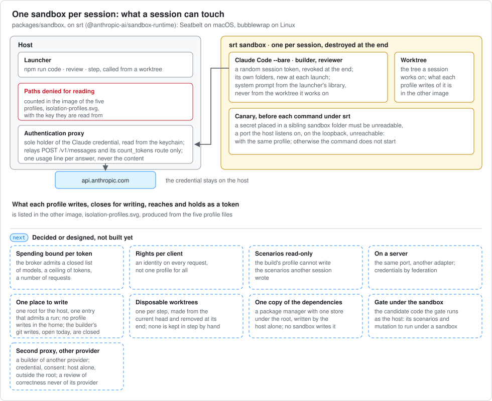
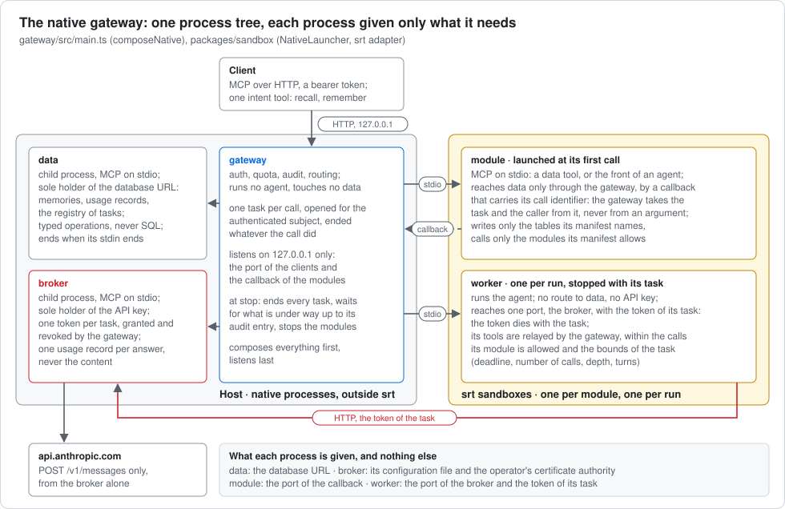
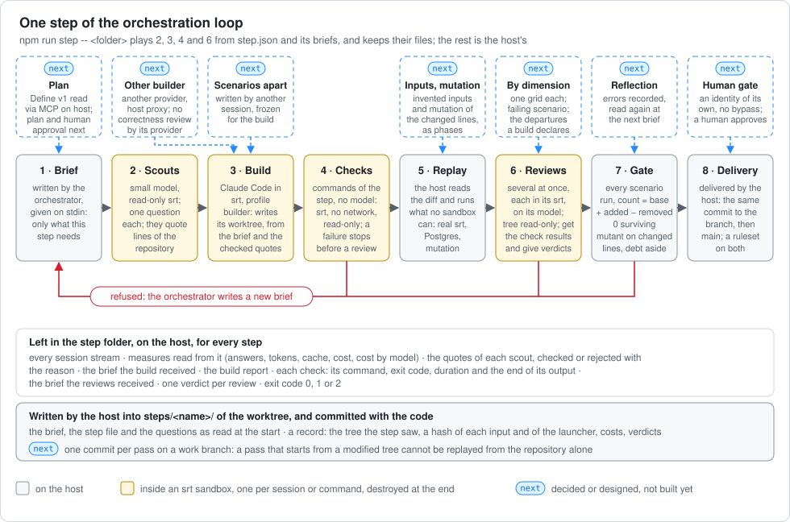

# architect-os

An MCP platform for agent work, built in public, and the method used to build it. Every Claude Code session runs in its own sandbox, every change passes a gate that counts scenarios and kills mutants, and every fact that enters the work is checked against the published literature.

**Status on 15 November 2026, branch `feat/gate-1a`.** The design is [`docs/design/platform-v3-srt.md`](docs/design/platform-v3-srt.md). The experiment log, failures included, is [`docs/design/journal.md`](docs/design/journal.md); the section numbers below (§) point into it.

## What the system brings

| What                                            | Measured                                                                                                                                                                                                                                                                                                                                                                                                                                                                                                                                                                                                                                                                                                                                                                                                                                           | Where                                                                                             |
| ----------------------------------------------- | -------------------------------------------------------------------------------------------------------------------------------------------------------------------------------------------------------------------------------------------------------------------------------------------------------------------------------------------------------------------------------------------------------------------------------------------------------------------------------------------------------------------------------------------------------------------------------------------------------------------------------------------------------------------------------------------------------------------------------------------------------------------------------------------------------------------------------------------------- | ------------------------------------------------------------------------------------------------- |
| Isolation, at a known price                     | A session cannot read the host's keys, reach anything but an authentication proxy, or write outside its worktree. It costs about 11 % more than the same session without a sandbox, on short tasks. A sandbox starts cold in 0.2 to 0.7 s (median) on the three hosts measured.                                                                                                                                                                                                                                                                                                                                                                                                                                                                                                                                                                    | [Cost baseline](#cost-baseline-the-fixed-cost-of-a-sessions-context-on-short-fix-tasks), §30, §38 |
| A context sized to the task                     | A session started with explicit inputs only costs 0.166 of the owner's everyday configuration on short fix tasks (95 % interval 0.131 to 0.212), with every task solved in both.                                                                                                                                                                                                                                                                                                                                                                                                                                                                                                                                                                                                                                                                   | Cost baseline                                                                                     |
| A gate that cannot be talked into green         | Executed scenarios must equal base + added − removed, and no mutant may survive on a changed line; the gate replays the mutation tool's verdicts instead of trusting them. On the last brick it found 10 survivors that three model reviews had missed.                                                                                                                                                                                                                                                                                                                                                                                                                                                                                                                                                                                            | §20, §37                                                                                          |
| Reviews in a read-only sandbox                  | The reviewer session cannot write, and its verdict is checked against a contract. On the last brick it found a link that made the host read outside the exchange folder, a named pipe that hung the verifier, and an unbounded read.                                                                                                                                                                                                                                                                                                                                                                                                                                                                                                                                                                                                               | §33, §37                                                                                          |
| Least privilege per process                     | In the native gateway, `data` alone holds the database URL and the broker alone holds the API key; a worker reaches one port, the broker, with a token that dies with its task; a module reaches data only through the gateway. A call opens a task in the name of the client the gateway authenticated, and a stop ends every task and waits for what is under way, up to its audit entry.                                                                                                                                                                                                                                                                                                                                                                                                                                                        | [The native gateway](#the-native-gateway), §41, §42                                               |
| Defects stopped before a push, at a known price | Wiring the native gateway took four steps and an end-to-end proof. Before anything was pushed, the reviews, the mutation run and the replay on the host found: a task left open for ever when its token could not be granted; a stop that returned while a module was still starting or a data operation still running; a message to a child already closed that would have brought the process down; client tokens as `openssl rand -base64 32` writes them refused without a word; and three pieces of code that no scenario could tell from their absence, which were removed. The build sessions cost $2.52 and the review sessions $9.57 (the orchestrator's own session is not counted). That ratio is a starting point, not a property of the architecture: see [The cost of review](#the-cost-of-review-and-what-is-expected-to-lower-it). | §40 to §45                                                                                        |
| Facts taken from publications, verified         | A question is answered from the literature and accepted only if each DOI exists, names the cited article, is not retracted, and the quoted passage is found word for word in the article's full text. Three real questions: 61 passages, 21 articles.                                                                                                                                                                                                                                                                                                                                                                                                                                                                                                                                                                                              | §37, §39                                                                                          |

## How it works

### One sandbox per session



Each session is one `srt` process ([`@anthropic-ai/sandbox-runtime`](https://github.com/anthropics/sandbox-runtime)) started from a profile and destroyed at the end. The credential never enters it: the session holds a random token that only the host's proxy accepts. Before every start a canary proves, with the real profile, that a secret in another sandbox's folder cannot be read and that a port outside the allow-list cannot be reached. Details: [`packages/sandbox/README.md`](packages/sandbox/README.md).

### The native gateway



The platform is one process tree. The gateway authenticates, counts, audits and routes; it runs no agent and touches no data. It starts two children outside srt, on a closed list of commands and variables with nothing inherited from the host: `data`, and the broker, the only process that holds the API key. Everything else runs in a sandbox: a module is started at its first call, a worker once per run and stopped with its task. The gateway composes all of it before it listens on anything, so a start that fails leaves nothing behind; its stop ends every task and returns only when nothing is under way. Each of these is a scenario, not a sentence: see [What is proven](#what-is-proven-and-how-to-replay-it). It is proven end to end: the process started by its entry file with nothing but its configuration, its two real children, real sandboxes, and a scripted model reached over HTTPS.

### One step of the orchestration loop



An orchestrator delegates each step to a fresh session that receives only the brief of that step. Nothing a session reports is taken on trust: the host reads the diff and runs what the sandbox cannot, a second session reviews without being able to write, and the gate decides. A refusal becomes a new brief that names the findings. Design: [`docs/design/orchestration-fable-5-2.md`](docs/design/orchestration-fable-5-2.md).

### How a step is tested and verified


No check is trusted alone. Scenarios say what the code must do. Mutation asks whether a scenario would notice each changed line breaking. A session that did not write the code reviews it against the design. Another fresh session invents inputs nobody used, with the expected result taken from the contract and not from the code. And what is claimed of an outside tool is measured before the real thing, by a script kept in the repository. Each has found what the others had not: on the step shown, the mutation run exposed lines that only looked proven (a run that never ended had been counted as a kill), the second review found a relay that lost the end of an answer, and the fresh inputs found three defects after both reviews. The gate then decides on counts read from the runner's own report, on the host and in CI. Design: [`docs/design/platform-v3-srt.md`](docs/design/platform-v3-srt.md), §7, and [`docs/design/orchestration-fable-5-2.md`](docs/design/orchestration-fable-5-2.md), §4; the step is in the journal, §51.

### The evidence desk


The loop does not take facts from the open web. It asks a question; a librarian answers from the published literature; a verifier on the host, plain code and not a model, accepts the answer or sends it back with named reasons. The contract does not say who the librarian is. Today it is Claude Science, in a session the owner starts once, which takes the questions as they arrive through a custom Remote connector. Design and threat model: [`docs/design/evidence-desk.md`](docs/design/evidence-desk.md).

### The cost of review, and what is expected to lower it

On the native gateway, review cost almost four times the build ($9.57 against $2.52), and no review was enough alone: each one found defects in the corrections that followed the one before. The owner's reading is that this is the price of iterative work done without comparison and without a history of similar work, and that it should fall once the orchestration loop feeds back on itself: a reflection at the end of a step, which records the decision taken and what the step produced, for the sessions that come after. Most agent harnesses and orchestration loops end with such a phase.

This is a hypothesis, stated before it is measured. Today the loop stops at the commit; the lessons of a step reach the next one only through the brief the orchestrator writes by hand, and the experiment log is a record of work and proofs written for a person, not an input of the sessions. The methodology of that feedback is still to be defined, so that it gets an architecture as fitted and as organised as the ones of the orchestration loop and of the isolation: where the record lives, who reflects, how a session is given what concerns it without loading everything, and how the effect is measured. It will start from the published state of the art, taken through the evidence desk, and its measure will be registered before it runs: review rounds and cost per step, against the four steps of the native gateway (§40 to §45). Design: [`docs/design/orchestration-fable-5-2.md`](docs/design/orchestration-fable-5-2.md), §4.

A first measure outside review came on the first step of Docker on the native path (§51). Two reviews of that step found 21 things, 11 of them on correctness. Then a fresh session was asked for inputs the scenarios did not use, a mechanism taken from Anthropic's `code-modernization` plugin at the owner's request: 57 scenarios written with the existing steps, each expectation taken from the contract and not from the code, for $1.64. Four failed on the host, exactly the four that session had announced: three defects that neither review nor the mutation run had seen (a profile could set a variable the adapter sets itself, the root of the host was accepted as the platform root, a path that `--mount` cannot carry was accepted). Fourteen of the 57 were kept. On that result the owner validated the principle: it is written in the design, applied by hand at each step that changes a behaviour, and not yet built into the loop's tool. On the next step (§52) it gave 71 inputs for $1.51 and found a check that ran again after it had passed; it also raised, as a possibility, that the kernel rounds a memory bound to a page, which a measure then confirmed: a bound that was not aligned would have refused every start.

## Where it stands

| Brick         | What                                                                                                                                                                                                                                                                                                                                                                                                               | State                                                                          | Log             |
| ------------- | ------------------------------------------------------------------------------------------------------------------------------------------------------------------------------------------------------------------------------------------------------------------------------------------------------------------------------------------------------------------------------------------------------------------ | ------------------------------------------------------------------------------ | --------------- |
| 1a.0          | The isolated code tool, `npm run code`: Claude Code under srt, no secret in the sandbox                                                                                                                                                                                                                                                                                                                            | done                                                                           | §14, §15, §21   |
| 1a            | Every test as a Gherkin scenario; the gate, `npm run gate`                                                                                                                                                                                                                                                                                                                                                         | done                                                                           | §16 to §20      |
| 0             | Cost baseline: 180 sessions over three launch configurations                                                                                                                                                                                                                                                                                                                                                       | done                                                                           | §22, §23        |
| 1b.1 to 1b.5  | The platform on srt: the `SandboxRunner` port, the broker, `data` as MCP, the gateway topology, the memory module and its worker                                                                                                                                                                                                                                                                                   | done; `recall` runs end to end through real sandboxes                          | §24 to §29      |
| Measure A     | What the structure costs in time, without a model                                                                                                                                                                                                                                                                                                                                                                  | done                                                                           | §30             |
| 1b exit       | The escape test: four profiles against eight attacks, in real sandboxes                                                                                                                                                                                                                                                                                                                                            | done on Linux and macOS                                                        | §35             |
| Hosts         | Windows through WSL2: the suite, the srt bench and the overhead measures                                                                                                                                                                                                                                                                                                                                           | done; the gate and real sessions were not run there                            | §38             |
| 1b.6a         | The gateway wired natively: one process that starts `data` and the broker as its children and the modules and workers under srt, composes before it listens, and stops with nothing left running; its configuration read from the environment with no default                                                                                                                                                      | done; proven end to end by its entry file                                      | §40 to §45      |
| 1b.6b         | Docker on the native path, as an alternative means of isolation. Built, proven before a real rootless daemon on x86-64 and arm64, then removed with the rest of Docker (decisions 21 and 22): srt runs on the three supported hosts, and the container isolated less than srt on two points                                                                                                                        | removed                                                                        | §47 to §56, §63 |
| 1b.6c         | The first realisation is removed (owner's decision of 16 November 2026, decision 21): its stack, its images, its workflow, the Docker adapter through which its memory service launched its workers, that service, and the HTTP paths between components. The proxy file moves to `deploy/edge/`. This is brick 1b.6 as it was first written; a first reading had kept the stack, repaired it and started it in CI | done                                                                           | §57, §61, §62   |
| 1b.6d         | The docs describe the platform as it is built, one architecture: `architecture.md`, `agents.md`, `testing.md`, `infrastructure.md`, `CLAUDE.md`, and an operating guide for a host ([`docs/operating.md`](docs/operating.md))                                                                                                                                                                                      | done                                                                           | §56 to §58      |
| 1b.7          | Stopped: it gave the stack of the first realisation a broker and a Docker client. What it found on the way and kept: the broker now listens before it answers its parent                                                                                                                                                                                                                                           | stopped, replaced by the removal above                                         | §59 to §62      |
| 1b.8          | The two pins the platform runs on are moved, one at a time, to what is published (the Claude Code binary 2.1.325, for a security fix; the sandbox runtime 0.0.83), with a record of what was read of the changelog and decided ([`docs/claude-code-watch.md`](docs/claude-code-watch.md)) and a scheduled workflow that turns red when a pin is behind                                                             | done                                                                           | §64             |
| O.1           | The loop in the repository: `npm run review`, `npm run step`                                                                                                                                                                                                                                                                                                                                                       | done                                                                           | §31 to §36      |
| O.2           | The loop through the gateway: builder and reviewer as platform modules                                                                                                                                                                                                                                                                                                                                             | not started; needs 1b.6                                                        |                 |
| O, feedback   | The loop feeds back on itself: a reflection at the end of a step records the decision and the output for later sessions                                                                                                                                                                                                                                                                                            | asked by the owner on 15 November 2026; its methodology is to be defined first | §44, §46        |
| S.1           | The evidence desk, `npm run evidence`                                                                                                                                                                                                                                                                                                                                                                              | done                                                                           | §37             |
| S, trial      | Claude Science as the librarian, through a Remote connector                                                                                                                                                                                                                                                                                                                                                        | three full rounds, outside production                                          | §39             |
| S.3, S.4      | Full texts fetched by the host; the desk as a platform module                                                                                                                                                                                                                                                                                                                                                      | open                                                                           |                 |
| 1c, 2 to 8, D | Marketplace, catalogue, code front, memory split, server deployment                                                                                                                                                                                                                                                                                                                                                | not started; see the design, §8                                                |                 |

## What is proven, and how to replay it

| Claim                                                                                                                        | Proof                                                                                                                                                                                                                                                                                                                                      | Command                                                                  |
| ---------------------------------------------------------------------------------------------------------------------------- | ------------------------------------------------------------------------------------------------------------------------------------------------------------------------------------------------------------------------------------------------------------------------------------------------------------------------------------------ | ------------------------------------------------------------------------ |
| No profile reads a host secret or another sandbox's folder, writes a git hook, or reaches the network outside its allow-list | `features/sandbox/escape.feature`: 32 attacks in real sandboxes, 5 witnesses without a sandbox where the same attacks succeed, 9 positive controls; Linux and macOS in CI                                                                                                                                                                  | `npm run gate -- --job macos`                                            |
| The platform runs on Windows through WSL2                                                                                    | 1,196 scenarios green out of 1,196, twice; the srt bench gives the same result as Linux CI, test by test                                                                                                                                                                                                                                   | `npm test`, then `cd bench && npm run bench:sandbox`                     |
| The credential stays on the host                                                                                             | `packages/sandbox/features/auth-proxy.feature`, `credential.feature`                                                                                                                                                                                                                                                                       | `npm test`                                                               |
| A tool call crosses the platform through real sandboxes                                                                      | `features/sandbox/recall.feature`, `remember.feature`: gateway, module, worker and data, with a scripted model                                                                                                                                                                                                                             | `npm test`                                                               |
| The gateway runs as one process, by its entry file                                                                           | `features/sandbox/gateway-entry.feature`: `node gateway/dist/src/serve.js` given only its configuration; `data` and the broker as its real children, module and worker under real srt, a scripted model over HTTPS; a client remembers, then recalls what it remembered; SIGTERM ends it with code 0 and nothing left listening or running | `npm test`                                                               |
| A client's call crosses the production composition with its identity                                                         | `features/sandbox/gateway-native.feature`: a real MCP client over HTTP with a bearer token, module and worker under real srt, a scripted model; the registry holds one task in the client's name, ended `completed`, and its usage; without a token, `UNAUTHORIZED` and no task opened                                                     | `npm test`                                                               |
| A stop leaves nothing under way, and a start that fails leaves nothing behind                                                | `gateway/features/gateway.feature`, `native-composition.feature`, `adapters.feature`: an opening, an end, a data operation or a module launch in flight is waited for; a step of the stop that fails does not prevent the next; a refused topology or a taken port is refused before anything listens                                      | `npm test`                                                               |
| The configuration has no default and its refusals leak nothing                                                               | `gateway/features/native-config.feature` (79 scenarios): every variable named in its refusal, never its value; the store that keeps nothing is chosen by name                                                                                                                                                                              | `npm test`                                                               |
| The gate refuses a filtered run, a skipped step, a surviving mutant, and a wrong verdict of the mutation tool                | `tools/test-gate/features/`, run against fixture reports                                                                                                                                                                                                                                                                                   | `npm run gate`                                                           |
| The cost figures above                                                                                                       | `baseline/`: tasks, harness, raw data, analysis                                                                                                                                                                                                                                                                                            | `npm run baseline:campaign`                                              |
| The overhead figures above                                                                                                   | `baseline/results/overhead-*.jsonl`                                                                                                                                                                                                                                                                                                        | `npm run baseline:overhead`                                              |
| The verifier refuses an unknown DOI, another article's DOI, a retracted article and an invented passage                      | `tools/evidence/features/` (280 scenarios), and one real run against `doi.org`: one sound answer verified, four false ones refused                                                                                                                                                                                                         | `npm test`, then `npm run evidence -- verify`                            |
| Claude Science answers the desk's questions without a gesture per question, once its session is started                      | Three questions, each verified at the first submission, in 7 to 19 minutes                                                                                                                                                                                                                                                                 | [`bench/evidence-remote`](bench/evidence-remote/README.md), with the app |

The whole suite is 1,610 scenarios. On the four steps of the native gateway, none of the 404 mutants of the changed lines survived at the gate (44, 44, 206, 110); on the evidence desk, none of 645; on the worker's failure message, none of 42.

## What is not proven

- **Windows beyond the suite.** Windows is supported through WSL2; native Windows is not planned for now (srt's own support for it is alpha and was not tried). Under WSL2 the suite, the srt bench and the overhead measures pass, but the gate with its mutation and real sessions were not run there (§38, §39).
- **The native gateway against Postgres and the real API.** Its end-to-end proof runs on the store that keeps nothing and before a scripted model. The same path against Postgres and against the real API has not been played through the entry file.
- **Rights per client.** One client profile exists (`owner`): every authenticated client has the owner's rights until a second profile and its resolution per client arrive (brick 2). It is written in the design, §8.
- **Savings on real work.** The baseline measures short fix tasks whose tests are named. Its own limits are stated below.
- **The context targets of the design** (tokens per task, per layer): they belong to bricks 2 and 3.
- **The orchestration loop against other ways of working.** One pilot, one session per cell: no statistical conclusion (§32).
- **That the cost of review falls.** It is expected to, once the loop feeds back on itself; nothing of that is built or measured yet, and its methodology is not defined ([The cost of review](#the-cost-of-review-and-what-is-expected-to-lower-it)).
- **That a quoted text is the article.** The verifier finds the passage in the text the librarian saved, and ties that text to the DOI by its title. Each record says so (`quote_in_supplied_text`); the host fetching the text itself is step S.3.
- **That a claim follows from its passage.** The verifier proves the passage exists in a real, unretracted article. The reasoning stays with review.
- **Claude Science without a person.** A session is started by hand; the app has no programmatic entry, and Anthropic's Consumer Terms forbid automating it. The question has been put to Anthropic (§37, §39).
- **The mutation debt register.** It names each known survivor by line and column, so an insertion above an entry used to strand it without anything saying so: 114 of its 295 entries no longer pointed at the code they named (§35, §60). The gate now refuses an entry that does not hold its text, on every run and whatever the run mutated, and `test-gate debt realign` puts back the entries whose code only moved, never by guessing: 112 were moved, 2 whose code is gone were removed, and the 293 that remain all point at their code (§66). Every survivor of a full mutation of the three files concerned has its entry. What is not proven is the register against the full run on Linux, which only runs from the default branch.

## Cost baseline: the fixed cost of a session's context, on short fix tasks

**What this measures, and what it does not.** It measures the cost a launch configuration adds to every session, on short tasks: one-line defects whose failing tests are named in the prompt, solved in a median of 4 to 8 turns depending on the configuration (29 at most) and about 25 seconds (13 to 46 seconds for 80 % of them). On sessions that short, the context loaded at start dominates the bill. It does **not** measure the cost of a real working session: on a long session of many turns, that fixed part is diluted and the gap between configurations is expected to shrink, by an amount not measured here. Every task was solved in every configuration (180 / 180), so these tasks cannot tell whether a configuration solves harder work less well. And srt is an isolation layer, not a saving: what it adds is the protection of the host, at a measured price.

Three configurations, with the same model (`claude-sonnet-5-5`), Claude Code version (2.1.318), prompt, permission mode and single allowed command:

- **host**: Claude Code as the owner uses it every day, with plugins, MCP servers, hooks and memory;
- **host-bare**: the same Claude Code with `--bare`, every input explicit, no sandbox;
- **srt**: the code tool of this repository (`packages/sandbox`): `--bare` inside the srt sandbox, the model reached through a local proxy that alone holds the credential. The session cannot read the host's keys or keychain, reach anything but the proxy, or write outside its worktree.

Twenty tasks on six public repositories of the owner (Python and TypeScript). Each injects a one-line defect into a disposable copy of a pinned commit and asks to make the named tests pass again without touching them; the check is verified to pass at the commit and fail with the defect before every session, and runs again on the host after it. Three repetitions per task and configuration. Cost is `total_cost_usd` of `claude -p --output-format json`, at public prices. The target repositories are never pushed; their branches and tags are compared before and after.

| Configuration | Solved  | Mean cost per session | Mean input tokens | Cache written per session | Mean turns |
| ------------- | ------- | --------------------- | ----------------- | ------------------------- | ---------- |
| host          | 60 / 60 | $0.192                | 169,300           | 42,100                    | 4.5        |
| host-bare     | 60 / 60 | $0.028                | 31,900            | 5,600                     | 7.8        |
| srt           | 60 / 60 | $0.032                | 41,600            | 6,100                     | 8.4        |

Cost ratios paired by task, mean and 95 % interval (bootstrap over the 20 tasks), **for these short sessions**: host-bare / host **0.146** (0.123 to 0.173); srt / host **0.166** (0.131 to 0.212); srt / host-bare **1.108** (1.021 to 1.213).

**Reading.** The gap between host and the two others comes from the context the usual configuration loads at every session: about 42,000 tokens written to the cache, against 6,000 with `--bare`. It comes from `--bare`, not from srt, and anyone gets it without a sandbox. Isolation costs about 11 % on these sessions: a little more context and a few more turns, partly because a test that depends on the host's `/tmp` and `HOME` fails inside the sandbox and the agent spends turns on it. `--bare` declares only Bash, Edit and Read to the model, and its sessions take more turns (7.8 against 4.5); whether that costs quality on harder work is not tested here.

**Limits.** One model and one version; one-line defects with named tests, easier than a real issue; one usual configuration, the owner's, so the gap depends on what a configuration loads; public prices, while the sessions ran on the owner's subscription. A cost study of real work needs real issues from the repositories' history, over several files and without named tests, a cost split into a fixed part and a part per turn, and tasks hard enough that not every session succeeds.

Everything is in `baseline/`: tasks, harness, defect generator, raw data and analysis, and the experiment log with its failures (`docs/design/journal.md`, §22 and §23). The campaign cost $15.11 at public prices.

```bash
npm run baseline:campaign
npm run baseline:analyze -- baseline/results/campaign-<date>.jsonl
```

## Quick start

Requires Node 26 LTS (`.nvmrc`) and npm. The sandbox scenarios need what srt needs: nothing more on macOS; `bubblewrap`, `socat` and `ripgrep` on Linux; on Windows, WSL2.

```bash
nvm use            # or any Node 26
npm ci
npm run check      # every scenario: typecheck, prettier, tests, architecture guard
npm run gate       # the CI gate: the count, the scenarios, the mutation of the changed lines
```

The platform as one process, on the store that keeps nothing (`DATABASE_URL` takes a `postgres://` URL otherwise). The broker reads the API key from the file its configuration names, mode 0600; a client token has at least 32 characters:

```bash
npx tsc -b
TOKEN="$(openssl rand -base64 32)"       # the bearer token the client presents
GATEWAY_TOKENS="$TOKEN=me" GATEWAY_PORT=8080 GATEWAY_QUOTA_PER_MINUTE=60 GATEWAY_PROFILE=owner \
BROKER_CONFIG="$PWD/modules/broker/broker.json" DATABASE_URL=memory \
node gateway/dist/src/serve.js           # MCP over HTTP on 127.0.0.1:8080/mcp; SIGTERM stops it
```

What the process needs of its host, what each refusal at start means, how long a stop takes and what is left after a kill: [docs/operating.md](docs/operating.md).

From a worktree at `<repo>/.claude/worktrees/<name>`, with a checkout of this branch as the launcher:

```bash
npm --prefix <launcher> run code                 # Claude Code in a sandbox, builder profile
npm --prefix <launcher> run review               # a read-only review session
npm --prefix <launcher> run step -- <folder>     # one step of the loop: build, then review
npm run evidence -- ask <ledger> <desk> <id> < question.txt
npm run evidence -- verify <ledger> <desk>
```

## Layout

```
client --> gateway --> module (srt, MCP on stdio)      a data tool
                  \--> worker (srt, one per task) --> broker --> api.anthropic.com
                  \--> data --> postgres + pgvector
```

| Path                  | Role                                                                                                                                                |
| --------------------- | --------------------------------------------------------------------------------------------------------------------------------------------------- |
| `packages/sandbox/`   | The `SandboxRunner` port, the srt adapter, the profiles, the launcher of the native children, the host's authentication proxy, the loop's commands. |
| `packages/contracts/` | The only shared package: `Result<T>`, `Run`, zod schemas of tools, data operations and evidence.                                                    |
| `gateway/`            | The single MCP server for clients: auth, catalogue, routing, quota, audit; it starts the modules.                                                   |
| `modules/`            | `broker` (sole holder of the API key, a token per task) and `memory`.                                                                               |
| `data/`               | The only component that imports `pg`; typed operations from `sql/`, served as MCP.                                                                  |
| `services/memory/`    | The intent tools `recall` and `remember` and their agent worker.                                                                                    |
| `tools/test-gate/`    | The CI gate.                                                                                                                                        |
| `tools/evidence/`     | The evidence desk.                                                                                                                                  |
| `baseline/`, `bench/` | Measurements and trials, outside production.                                                                                                        |
| `docs/`               | Architecture, design notes, the experiment log, testing.                                                                                            |

The architecture is enforced, not just described: `npm run arch` fails on a wrong layer import, a cross-component import, `pg` outside `data/src/infrastructure`, a process launched outside `packages/sandbox`, the agent SDK outside a worker, the MCP SDK outside presentation and infrastructure, or a cycle.

## The first realisation, removed

A first realisation ran each component in a container behind a proxy, the components talking over HTTP. Its memory service owned the intent tools and launched its own workers through the socket of the Docker daemon. It was removed on 16 November 2026 (design, decision 21; journal, §61 and §62): the platform's rule is that the gateway launches and that memory is a data brick, and measured, that stack had never served an agent (§57, §59). What remains of it is `deploy/edge/Caddyfile`, an example of an edge in front of the gateway's loopback port.

## Working with Claude

`CLAUDE.md` holds the commands, boundaries and the "what the review must refuse" list. `.claude/agents/` has three review subagents, `.claude/commands/review-pr.md` runs them, and `.github/workflows/` runs Claude on `@claude` mentions and on pull requests (workflows from `anthropics/claude-code-action`).

## Documentation

[Platform design](docs/design/platform-v3-srt.md) | [Orchestration loop](docs/design/orchestration-fable-5-2.md) | [Evidence desk](docs/design/evidence-desk.md) | [Experiment log](docs/design/journal.md) | [Architecture](docs/architecture.md) | [Infrastructure](docs/infrastructure.md) | [Design decisions](docs/design.md) | [Agents](docs/agents.md) | [Testing](docs/testing.md) | [Contributing](CONTRIBUTING.md) | [Security](SECURITY.md) | [Changelog](CHANGELOG.md)

## License

MIT, see [LICENSE](LICENSE).
