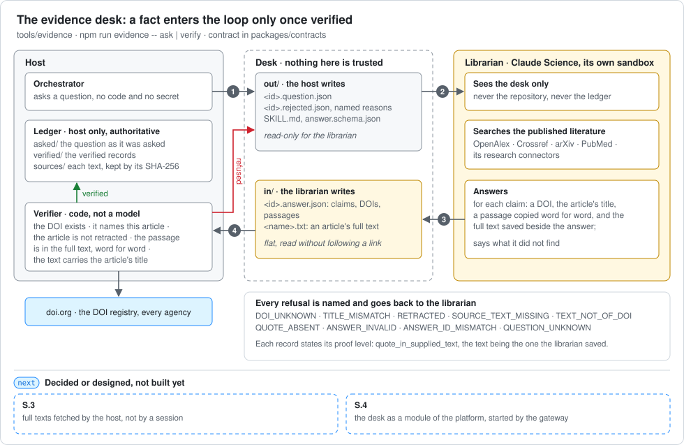

# architect-os

An MCP platform for agent work, built in public, and the method used to build it. Every Claude Code session runs in its own sandbox, every change passes a gate that counts scenarios and kills mutants, and every fact that enters the work is checked against the published literature.

**Status on 15 November 2026, branch `feat/gate-1a`.** The design is [`docs/design/platform-v3-srt.md`](docs/design/platform-v3-srt.md). The experiment log, failures included, is [`docs/design/journal.md`](docs/design/journal.md); the section numbers below (§) point into it.

## What the system brings

| What                                    | Measured                                                                                                                                                                                                                                                                        | Where                                                                                             |
| --------------------------------------- | ------------------------------------------------------------------------------------------------------------------------------------------------------------------------------------------------------------------------------------------------------------------------------- | ------------------------------------------------------------------------------------------------- |
| Isolation, at a known price             | A session cannot read the host's keys, reach anything but an authentication proxy, or write outside its worktree. It costs about 11 % more than the same session without a sandbox, on short tasks. A sandbox starts cold in 0.2 to 0.7 s (median) on the three hosts measured. | [Cost baseline](#cost-baseline-the-fixed-cost-of-a-sessions-context-on-short-fix-tasks), §30, §38 |
| A context sized to the task             | A session started with explicit inputs only costs 0.166 of the owner's everyday configuration on short fix tasks (95 % interval 0.131 to 0.212), with every task solved in both.                                                                                                | Cost baseline                                                                                     |
| A gate that cannot be talked into green | Executed scenarios must equal base + added − removed, and no mutant may survive on a changed line; the gate replays the mutation tool's verdicts instead of trusting them. On the last brick it found 10 survivors that three model reviews had missed.                         | §20, §37                                                                                          |
| Reviews in a read-only sandbox          | The reviewer session cannot write, and its verdict is checked against a contract. On the last brick it found a link that made the host read outside the exchange folder, a named pipe that hung the verifier, and an unbounded read.                                            | §33, §37                                                                                          |
| Facts taken from publications, verified | A question is answered from the literature and accepted only if each DOI exists, names the cited article, is not retracted, and the quoted passage is found word for word in the article's full text. Three real questions: 61 passages, 21 articles.                           | §37, §39                                                                                          |

## How it works

### One sandbox per session


Each session is one `srt` process ([`@anthropic-ai/sandbox-runtime`](https://github.com/anthropics/sandbox-runtime)) started from a profile and destroyed at the end. The credential never enters it: the session holds a random token that only the host's proxy accepts. Before every start a canary proves, with the real profile, that a secret in another sandbox's folder cannot be read and that a port outside the allow-list cannot be reached. Details: [`packages/sandbox/README.md`](packages/sandbox/README.md).

### One step of the orchestration loop


An orchestrator delegates each step to a fresh session that receives only the brief of that step. Nothing a session reports is taken on trust: the host reads the diff and runs what the sandbox cannot, a second session reviews without being able to write, and the gate decides. A refusal becomes a new brief that names the findings. Design: [`docs/design/orchestration-fable-5-2.md`](docs/design/orchestration-fable-5-2.md).

### The evidence desk



The loop does not take facts from the open web. It asks a question; a librarian answers from the published literature; a verifier on the host, plain code and not a model, accepts the answer or sends it back with named reasons. The contract does not say who the librarian is. Today it is Claude Science, in a session the owner starts once, which takes the questions as they arrive through a custom Remote connector. Design and threat model: [`docs/design/evidence-desk.md`](docs/design/evidence-desk.md).

## Where it stands

| Brick         | What                                                                                                                             | State                                                        | Log           |
| ------------- | -------------------------------------------------------------------------------------------------------------------------------- | ------------------------------------------------------------ | ------------- |
| 1a.0          | The isolated code tool, `npm run code`: Claude Code under srt, no secret in the sandbox                                          | done                                                         | §14, §15, §21 |
| 1a            | Every test as a Gherkin scenario; the gate, `npm run gate`                                                                       | done                                                         | §16 to §20    |
| 0             | Cost baseline: 180 sessions over three launch configurations                                                                     | done                                                         | §22, §23      |
| 1b.1 to 1b.5  | The platform on srt: the `SandboxRunner` port, the broker, `data` as MCP, the gateway topology, the memory module and its worker | done; `recall` runs end to end through real sandboxes        | §24 to §29    |
| Measure A     | What the structure costs in time, without a model                                                                                | done                                                         | §30           |
| 1b exit       | The escape test: four profiles against eight attacks, in real sandboxes                                                          | done on Linux and macOS                                      | §35           |
| Hosts         | Windows through WSL2: the suite, the srt bench and the overhead measures                                                         | done; the gate and real sessions were not run there          | §38           |
| 1b.6          | Removal of the earlier container stack (`compose.yaml`, `proxy/`, the Docker worker)                                             | the owner's decision, now that the Windows proof is recorded | §29, §35, §38 |
| O.1           | The loop in the repository: `npm run review`, `npm run step`                                                                     | done                                                         | §31 to §36    |
| O.2           | The loop through the gateway: builder and reviewer as platform modules                                                           | not started; needs 1b.6                                      |               |
| S.1           | The evidence desk, `npm run evidence`                                                                                            | done                                                         | §37           |
| S, trial      | Claude Science as the librarian, through a Remote connector                                                                      | three full rounds, outside production                        | §39           |
| S.3, S.4      | Full texts fetched by the host; the desk as a platform module                                                                    | open                                                         |               |
| 1c, 2 to 8, D | Marketplace, catalogue, code front, memory split, server deployment                                                              | not started; see the design, §8                              |               |

## What is proven, and how to replay it

| Claim                                                                                                                        | Proof                                                                                                                                                                     | Command                                                                  |
| ---------------------------------------------------------------------------------------------------------------------------- | ------------------------------------------------------------------------------------------------------------------------------------------------------------------------- | ------------------------------------------------------------------------ |
| No profile reads a host secret or another sandbox's folder, writes a git hook, or reaches the network outside its allow-list | `features/sandbox/escape.feature`: 32 attacks in real sandboxes, 5 witnesses without a sandbox where the same attacks succeed, 9 positive controls; Linux and macOS in CI | `npm run gate -- --job macos`                                            |
| The platform runs on Windows through WSL2                                                                                    | 1,196 scenarios green out of 1,196, twice; the srt bench gives the same result as Linux CI, test by test                                                                  | `npm test`, then `cd bench && npm run bench:sandbox`                     |
| The credential stays on the host                                                                                             | `packages/sandbox/features/auth-proxy.feature`, `credential.feature`                                                                                                      | `npm test`                                                               |
| A tool call crosses the platform through real sandboxes                                                                      | `features/sandbox/recall.feature`, `remember.feature`: gateway, module, worker and data, with a scripted model                                                            | `npm test`                                                               |
| The gate refuses a filtered run, a skipped step, a surviving mutant, and a wrong verdict of the mutation tool                | `tools/test-gate/features/`, run against fixture reports                                                                                                                  | `npm run gate`                                                           |
| The cost figures above                                                                                                       | `baseline/`: tasks, harness, raw data, analysis                                                                                                                           | `npm run baseline:campaign`                                              |
| The overhead figures above                                                                                                   | `baseline/results/overhead-*.jsonl`                                                                                                                                       | `npm run baseline:overhead`                                              |
| The verifier refuses an unknown DOI, another article's DOI, a retracted article and an invented passage                      | `tools/evidence/features/` (280 scenarios), and one real run against `doi.org`: one sound answer verified, four false ones refused                                        | `npm test`, then `npm run evidence -- verify`                            |
| Claude Science answers the desk's questions without a gesture per question, once its session is started                      | Three questions, each verified at the first submission, in 7 to 19 minutes                                                                                                | [`bench/evidence-remote`](bench/evidence-remote/README.md), with the app |

The whole suite is 1,478 scenarios. On the last brick, none of the 645 mutants of the changed lines survived.

## What is not proven

- **Windows beyond WSL2.** Native Windows was not tried: srt's own support for it is alpha. Under WSL2 the suite, the srt bench and the overhead measures pass, but the gate with its mutation and real sessions were not run there (§38).
- **Savings on real work.** The baseline measures short fix tasks whose tests are named. Its own limits are stated below.
- **The context targets of the design** (tokens per task, per layer): they belong to bricks 2 and 3.
- **The orchestration loop against other ways of working.** One pilot, one session per cell: no statistical conclusion (§32).
- **That a quoted text is the article.** The verifier finds the passage in the text the librarian saved, and ties that text to the DOI by its title. Each record says so (`quote_in_supplied_text`); the host fetching the text itself is step S.3.
- **That a claim follows from its passage.** The verifier proves the passage exists in a real, unretracted article. The reasoning stays with review.
- **Claude Science without a person.** A session is started by hand; the app has no programmatic entry, and Anthropic's Consumer Terms forbid automating it. The question has been put to Anthropic (§37, §39).
- **The mutation debt register.** For the srt adapter, 11 of its 102 entries still point at the code they name (§35); it has to be rebuilt.

## Cost baseline: the fixed cost of a session's context, on short fix tasks

**What this measures, and what it does not.** It measures the cost a launch configuration adds to every session, on short tasks: one-line defects whose failing tests are named in the prompt, solved in a median of 4 to 8 turns depending on the configuration (29 at most) and about 25 seconds (13 to 46 seconds for 80 % of them). On sessions that short, the context loaded at start dominates the bill. It does **not** measure the cost of a real working session: on a long session of many turns, that fixed part is diluted and the gap between configurations is expected to shrink, by an amount not measured here. Every task was solved in every configuration (180 / 180), so these tasks cannot tell whether a configuration solves harder work less well. And srt is an isolation layer, not a saving: what it adds is the protection of the host, at a measured price.

Three configurations, with the same model (`claude-sonnet-5-5`), Claude Code version (2.1.318), prompt, permission mode and single allowed command:

- **host**: Claude Code as the owner uses it every day, with plugins, MCP servers, hooks and memory;
- **host-bare**: the same Claude Code with `--bare`, every input explicit, no sandbox;
- **srt**: the code tool of this repository (`packages/sandbox`): `--bare` inside the srt sandbox, the model reached through a local proxy that alone holds the credential. The session cannot read the host's keys or keychain, reach anything but the proxy, or write outside its worktree.

Twenty tasks on six public repositories of the owner (Python and TypeScript). Each injects a one-line defect into a disposable copy of a pinned commit and asks to make the named tests pass again without touching them; the check is verified to pass at the commit and fail with the defect before every session, and runs again on the host after it. Three repetitions per task and configuration. Cost is `total_cost_usd` of `claude -p --output-format json`, at public prices. The target repositories are never pushed; their branches and tags are compared before and after.

| Configuration | Solved  | Mean cost per session | Mean input tokens | Cache written per session | Mean turns |
| ------------- | ------- | --------------------- | ----------------- | ------------------------- | ---------- |
| host          | 60 / 60 | $0.192                | 169,300           | 42,100                    | 4.5        |
| host-bare     | 60 / 60 | $0.028                | 31,900            | 5,600                     | 7.8        |
| srt           | 60 / 60 | $0.032                | 41,600            | 6,100                     | 8.4        |

Cost ratios paired by task, mean and 95 % interval (bootstrap over the 20 tasks), **for these short sessions**: host-bare / host **0.146** (0.123 to 0.173); srt / host **0.166** (0.131 to 0.212); srt / host-bare **1.108** (1.021 to 1.213).

**Reading.** The gap between host and the two others comes from the context the usual configuration loads at every session: about 42,000 tokens written to the cache, against 6,000 with `--bare`. It comes from `--bare`, not from srt, and anyone gets it without a sandbox. Isolation costs about 11 % on these sessions: a little more context and a few more turns, partly because a test that depends on the host's `/tmp` and `HOME` fails inside the sandbox and the agent spends turns on it. `--bare` declares only Bash, Edit and Read to the model, and its sessions take more turns (7.8 against 4.5); whether that costs quality on harder work is not tested here.

**Limits.** One model and one version; one-line defects with named tests, easier than a real issue; one usual configuration, the owner's, so the gap depends on what a configuration loads; public prices, while the sessions ran on the owner's subscription. A cost study of real work needs real issues from the repositories' history, over several files and without named tests, a cost split into a fixed part and a part per turn, and tasks hard enough that not every session succeeds.

Everything is in `baseline/`: tasks, harness, defect generator, raw data and analysis, and the experiment log with its failures (`docs/design/journal.md`, §22 and §23). The campaign cost $15.11 at public prices.

```bash
npm run baseline:campaign
npm run baseline:analyze -- baseline/results/campaign-<date>.jsonl
```

## Quick start

Requires Node 26 LTS (`.nvmrc`) and npm. The sandbox scenarios need what srt needs: nothing more on macOS; `bubblewrap`, `socat` and `ripgrep` on Linux; on Windows, WSL2.

```bash
nvm use            # or any Node 26
npm ci
npm run check      # every scenario: typecheck, prettier, tests, architecture guard
npm run gate       # the CI gate: the count, the scenarios, the mutation of the changed lines
```

From a worktree at `<repo>/.claude/worktrees/<name>`, with a checkout of this branch as the launcher:

```bash
npm --prefix <launcher> run code                 # Claude Code in a sandbox, builder profile
npm --prefix <launcher> run review               # a read-only review session
npm --prefix <launcher> run step -- <folder>     # one step of the loop: build, then review
npm run evidence -- ask <ledger> <desk> <id> < question.txt
npm run evidence -- verify <ledger> <desk>
```

## Layout

```
client --> gateway --> module (srt, MCP on stdio)      a data tool
                  \--> worker (srt, one per task) --> broker --> api.anthropic.com
                  \--> data --> postgres + pgvector
```

| Path                  | Role                                                                                                           |
| --------------------- | -------------------------------------------------------------------------------------------------------------- |
| `packages/sandbox/`   | The `SandboxRunner` port, the srt adapter, the profiles, the host's authentication proxy, the loop's commands. |
| `packages/contracts/` | The only shared package: `Result<T>`, `Run`, zod schemas of tools, data operations and evidence.               |
| `gateway/`            | The single MCP server for clients: auth, catalogue, routing, quota, audit; it starts the modules.              |
| `modules/`            | `broker` (sole holder of the API key, a token per task) and `memory`.                                          |
| `data/`               | The only component that imports `pg`; typed operations from `sql/`, served as MCP.                             |
| `services/memory/`    | The intent tools `recall` and `remember` and their agent worker.                                               |
| `tools/test-gate/`    | The CI gate.                                                                                                   |
| `tools/evidence/`     | The evidence desk.                                                                                             |
| `baseline/`, `bench/` | Measurements and trials, outside production.                                                                   |
| `docs/`               | Architecture, design notes, the experiment log, testing.                                                       |

The architecture is enforced, not just described: `npm run arch` fails on a wrong layer import, a cross-component import, `pg` outside `data/src/infrastructure`, a process launched outside `packages/sandbox`, the agent SDK outside a worker, the MCP SDK outside presentation and infrastructure, or a cycle.

## The earlier container stack

The first realisation ran each worker in a container behind a Caddy proxy. It is still in the tree (`compose.yaml`, `proxy/`). Its removal is brick 1b.6, the owner's decision now that the Windows proof under WSL2 is recorded (§38).

```bash
cp .env.example .env           # fill the placeholders
docker compose build
docker compose --profile build-only build memory-worker
docker compose up
curl http://127.0.0.1:8080/healthz
```

## Working with Claude

`CLAUDE.md` holds the commands, boundaries and the "what the review must refuse" list. `.claude/agents/` has three review subagents, `.claude/commands/review-pr.md` runs them, and `.github/workflows/` runs Claude on `@claude` mentions and on pull requests (workflows from `anthropics/claude-code-action`).

## Documentation

[Platform design](docs/design/platform-v3-srt.md) | [Orchestration loop](docs/design/orchestration-fable-5-2.md) | [Evidence desk](docs/design/evidence-desk.md) | [Experiment log](docs/design/journal.md) | [Architecture](docs/architecture.md) | [Infrastructure](docs/infrastructure.md) | [Design decisions](docs/design.md) | [Agents](docs/agents.md) | [Testing](docs/testing.md) | [Contributing](CONTRIBUTING.md) | [Security](SECURITY.md) | [Changelog](CHANGELOG.md)

## License

MIT, see [LICENSE](LICENSE).
